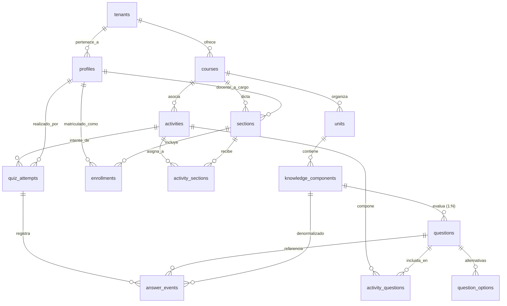
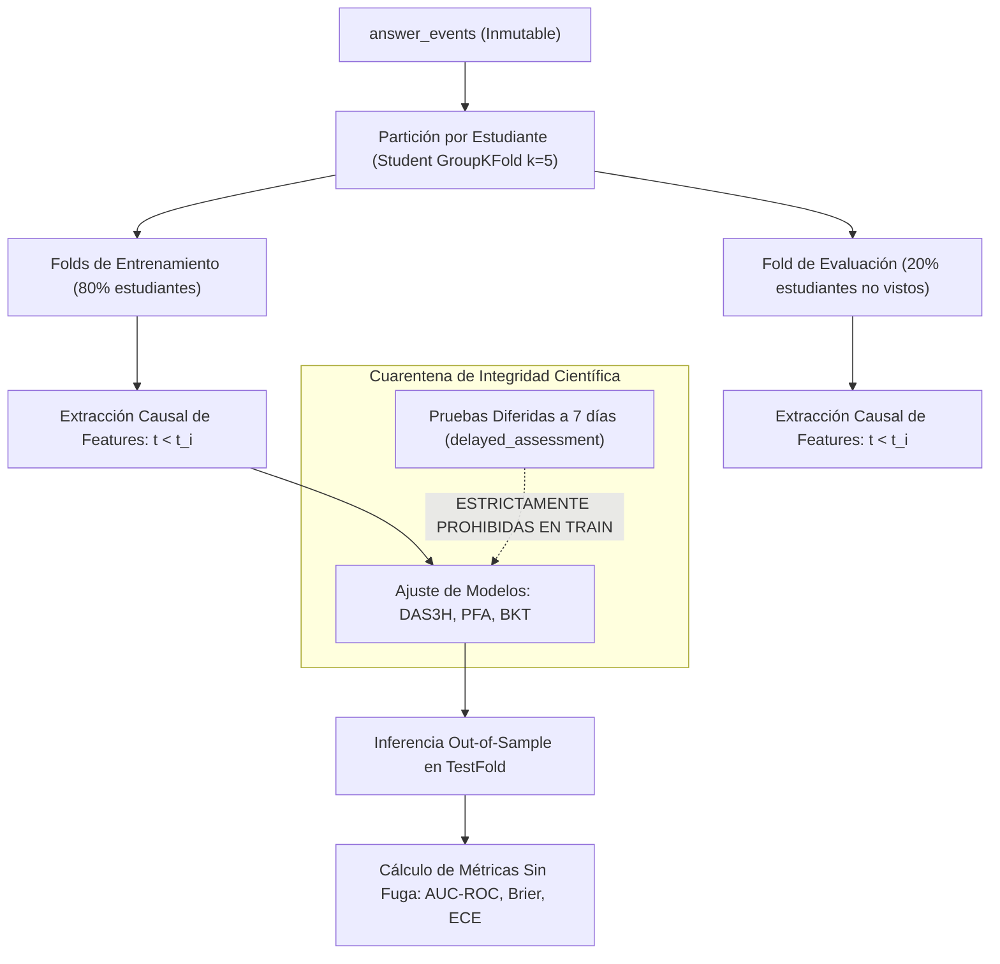

# TASK M5.0 — Auditoría de Datos y Especificación del Dataset para Knowledge Tracing

**Proyecto:** PlataformaMicro — Sistema Web de Microaprendizaje Adaptativo (5to Secundaria)  
**Hito:** M5.0 — Data Readiness Audit, Dataset Specification & Predictive Modeling Architecture  
**Fecha:** Noviembre 2026  
**Rol:** ML Engineer / Data Engineer / Educational Data Mining Researcher  
**Estado:** ✅ **COMPLETADO (Auditoría Integral y Especificación Aprobada)**

---

## 1. Esquema Real de Base de Datos y Relaciones Verificadas

Se inspeccionaron las 6 migraciones activas de Supabase (`supabase/migrations/`) y el esquema vivo en el servidor PostgreSQL local (puerto `54322`, base de datos `postgres`):

```
supabase/migrations/
├── 20261102000000_initial_schema.sql
├── 20261102180000_content_generation_quizzes_notifications.sql
├── 20261103000000_content_generation_leases_and_idempotency.sql
├── 20261103010000_content_generation_hardening.sql
├── 20261103020000_teacher_question_editor_m3.sql
└── 20261103030000_learning_flow_and_answer_events_m4.sql
```

### 1.1. Tablas Centrales del Dominio Educativo



### 1.2. Hallazgos Críticos del Esquema PostgreSQL

1. **Timestamp Canónico de Interacción:**
   - La columna canónica es `answer_events.event_timestamp` (`timestamptz NOT NULL DEFAULT now()`).
   - Se genera de forma estrictamente determinista en el servidor de base de datos en el instante del `INSERT`. El cliente web no puede manipular este valor.

2. **Relación Pregunta ↔ Componente de Conocimiento (KC):**
   - **Cardinalidad 1:N estricta:** `questions.knowledge_component_id` es una clave foránea `NOT NULL REFERENCES knowledge_components(id) ON DELETE RESTRICT`.
   - **No existe tabla intermedia de unión (junction table) para relaciones N:M.** Cada pregunta evalúa única y exclusivamente **un único KC**.
   - **Q-Matrix:** La matriz de incidencia Pregunta-KC ($Q \in \{0, 1\}^{I \times K}$) es una matriz rala donde cada fila $i$ tiene exactamente una sola entrada igual a $1$ ($\sum_k q_{ik} = 1$). Esto simplifica notablemente la formulación de PFA, BKT y DAS3H al evitar ambigüedades en la atribución de crédito/culpa entre múltiples conceptos.

3. **Representación de Intentos y Reintentos:**
   - **Nivel Sesión (`quiz_attempts`):** Cada intento de actividad genera un registro con `attempt_number` secuencial ($1, 2, \dots$), gobernado por `activities.max_attempts`. Existe un índice único parcial `idx_quiz_attempts_active_unique` que prohíbe tener más de un intento `in_progress` simultáneo por estudiante y actividad.
   - **Nivel Reactivo (`answer_events`):** Dentro de un intento, cada respuesta a una pregunta es un evento inmutable con `question_sequence` ($1, 2, \dots, N$). El intento se cierra de forma transaccional actualizando `quiz_attempts.status = 'completed'` y computando el puntaje final mediante el trigger de base de datos `compute_attempt_score`.

4. **Medición de Tiempo de Respuesta:**
   - Existen dos campos complementarios en `answer_events`:
     - `response_time_seconds`: `numeric(6,2) NOT NULL CHECK (response_time_seconds > 0)`.
     - `response_time_ms`: `integer CHECK (response_time_ms IS NULL OR response_time_ms > 0)`.
   - Permiten detectar anomalías de conducta (speed-guessing $< 2.0$s o timeouts $> 300$s).

5. **Inmutabilidad y Blindaje Criptográfico de `answer_events`:**
   - **Nivel de Privilegios:** Se ejecutó `REVOKE UPDATE, DELETE, TRUNCATE ON answer_events FROM anon, authenticated;`.
   - **Nivel de Trigger:** El trigger `trg_prevent_answer_events_mutation` (disparado `BEFORE DELETE OR UPDATE`) ejecuta `prevent_answer_events_mutation()`, arrojando una excepción estricta de PostgreSQL con código `ERRCODE 55000` ("answer_events table is strictly append-only; UPDATE and DELETE operations are forbidden").
   - **Nivel de Truncado:** El trigger `trg_prevent_answer_events_truncate` bloquea cualquier intento de `TRUNCATE`.
   - **Nivel de Idempotencia:** `idempotency_key` con restricción `UNIQUE` evita duplicación de registros por retransmisiones de red.

6. **Dificultad de los Ítems y Componentes:**
   - `questions.difficulty`: `numeric(4,3) NOT NULL DEFAULT 0.500 CHECK (difficulty >= 0.0 AND difficulty <= 1.0)`.
   - `knowledge_components.difficulty_prior`: `numeric(4,3) NOT NULL DEFAULT 0.500 CHECK (difficulty_prior >= 0.0 AND difficulty_prior <= 1.0)`.
   - No existe campo `bloom_level` en `questions` canónicas (solo en `question_drafts.suggested_bloom_level`).

7. **Aislamiento Multitenant y Autorización por Sección:**
   - Cadena de pertenencia autorizada: `profiles.id` (estudiante) $\rightarrow$ `enrollments.section_id` $\rightarrow$ `activity_sections.activity_id` $\rightarrow$ `activity_questions.question_id`.
   - Las políticas RLS (`answer_events_insert` y `answer_events_select`) y la verificación en `learning_repository.py` garantizan que un estudiante únicamente puede registrar eventos en actividades formalmente asignadas a sus secciones.

---

## 2. Procedencia de Cada Variable del Dataset

| Variable del Dataset | Tabla Origen / Expresión | Modo de Generación | Justificación y Validación de Integridad |
| :--- | :--- | :--- | :--- |
| `student_id_pseudo` | `enrollments.student_id_pseudo` | Generado en BD (`gen_random_uuid()`) | Seudónimo anonimizado estricto. Aísla la identidad civil del estudiante (sin PII). |
| `question_id` | `questions.id` | Clave primaria persistida | Identificador único del reactivo evaluado. |
| `knowledge_component_id` | `answer_events.knowledge_component_id` | Denormalizado al insertar evento | Resuelto en backend desde `questions.knowledge_component_id` e insertado directamente. |
| `event_timestamp` | `answer_events.event_timestamp` | Servidor DB (`now()`) | Timestamp canónico para ordenamiento cronológico y cálculo de ventanas de decaimiento. |
| `is_correct` | `answer_events.is_correct` | Servidor API (`learning_repository.py`) | **Calculado en backend:** Compara `selected_option_id` contra `question_options.is_correct`. No es provisto por el cliente. |
| `question_sequence` | `answer_events.question_sequence` | Secuencial en intento | Orden de presentación ordinal del reactivo dentro del intento. |
| `attempt_id` | `quiz_attempts.id` | Clave primaria persistida | Identificador de la sesión de evaluación. |
| `attempt_number` | `answer_events.attempt_number` | Secuencial de actividad | Número de reintento de la actividad por el estudiante ($1, 2, \dots$). |
| `activity_id` | `activities.id` | Clave foránea persistida | Permite diferenciar prácticas formativas de evaluaciones diferidas a 7 días. |
| `activity_type` | `activities.activity_type` | Enum tipado | Diferencia `formative`, `practice`, `immediate_assessment` y `delayed_assessment`. |
| `response_time_seconds`| `answer_events.response_time_seconds`| Cliente $\rightarrow$ validado en API | Latencia de resolución en segundos ($t > 0$). |
| `item_difficulty_prior` | `questions.difficulty` | Calibración previa | Prior bayesiano de dificultad del reactivo ($[0, 1]$). |
| `kc_difficulty_prior` | `knowledge_components.difficulty_prior` | Calibración previa | Prior bayesiano de dificultad del concepto ($[0, 1]$). |

---

## 3. Diccionario de Datos del Dataset Canónico

| Campo | Tipo SQL / Pandas | Rango / Formato | Nulable | Descripción Funcional |
| :--- | :--- | :--- | :---: | :--- |
| `event_id` | `UUID` / `string` | UUIDv4 | No | Clave primaria inmutable del evento de respuesta. |
| `student_id_pseudo` | `UUID` / `string` | UUIDv4 | No | Identificador seudonimizado del alumno. |
| `kc_id` | `UUID` / `string` | UUIDv4 | No | Componente de conocimiento evaluado. |
| `question_id` | `UUID` / `string` | UUIDv4 | No | Reactivo específico presentado. |
| `activity_id` | `UUID` / `string` | UUIDv4 | Sí | Actividad curricular contenedora. |
| `attempt_id` | `UUID` / `string` | UUIDv4 | No | Sesión de cuestionario. |
| `activity_type` | `string` | `diagnostic`, `practice`, `delayed_assessment`, etc. | No | Propósito pedagógico de la actividad. |
| `attempt_number` | `int16` | $\ge 1$ | No | Número ordinal de intento de la actividad. |
| `question_sequence` | `int16` | $\ge 1$ | No | Posición cronológica dentro del intento. |
| `event_timestamp` | `datetime64[ns, UTC]` | ISO 8601 UTC | No | Momento exacto de registro de la respuesta. |
| `is_correct` | `int8` | $\{0, 1\}$ | No | Variable binaria observada de éxito ($y_{i}$). |
| `response_time_seconds`| `float32` | $(0.0, 3600.0]$ | No | Tiempo transcurrido de resolución. |
| `item_difficulty_prior` | `float32` | $[0.0, 1.0]$ | No | Dificultad base parametrizada en la pregunta. |
| `kc_difficulty_prior` | `float32` | $[0.0, 1.0]$ | No | Dificultad base parametrizada en el KC. |

---

## 4. Estadísticas Agregadas de Disponibilidad de Datos

Se ejecutaron consultas de inspección directas sobre la base de datos de desarrollo de Supabase (`127.0.0.1:54322`, base `postgres`):

| Métrica de Disponibilidad | Valor Actual en DB Desarrollo | Estado de Preparación |
| :--- | :---: | :--- |
| **Estudiantes con interacciones válidas** | **0** | Sin eventos registrados |
| **Total de respuestas registradas (`answer_events`)** | **0** | Tabla en estado append-only vacía |
| **Preguntas aprobadas y publicadas** | **1** | "Fotosíntesis" (4 opciones de respuesta) |
| **Componentes de conocimiento (KCs) en catálogo**| **1** | "Fotosíntesis" (Unidad Nutrición y Metabolismo) |
| **Unidades curriculares activas** | **4** | Estructura celular, Nutrición, Genética, Ecología |
| **Cursos registrados** | **1** | Ciencias (5to de Secundaria) |
| **Secciones registradas** | **1** | 5.° A |
| **Estudiantes matriculados (`enrollments`)** | **1** | Seudónimo generado, 0 intentos ejecutados |
| **Actividades curriculares creadas** | **0** | Cuestionarios aún no instanciados en dev |
| **Intentos de evaluación (`quiz_attempts`)** | **0** | Ningún intento iniciado |
| **Distribución de aciertos vs errores** | **N/A (0 / 0)** | Indeterminado |
| **Distribución de intervalos temporales ($\Delta t$)** | **N/A** | Indeterminado |
| **Porcentaje de estudiantes en Cold-Start ($N < 3$)** | **100% (1/1)** | Todos los estudiantes sin historial |
| **Eventos descartados / corruptos** | **0% (0)** | Ningún evento inválido |

> [!IMPORTANT]
> **Aislamiento Estricto:** La base de datos de desarrollo en el puerto `54322` está completamente disociada de la base `plataformamicro_test` (puerto `5432`). Los registros de prueba de Pytest permanecen aislados y no han sido combinados con los datos institucionales.

---

## 5. Diagnóstico de Suficiencia para PFA, BKT y DAS3H

### 5.1. Performance Factor Analysis (PFA)
- **Formulación:**
  $$\text{logit}(P(R=1)) = \beta_k + \gamma_k S_{s,k} + \rho_k F_{s,k}$$
  Donde $S_{s,k}$ y $F_{s,k}$ representan el conteo acumulado de aciertos y fallos previos del estudiante $s$ en el KC $k$.
- **Requerimientos Mínimos:**
  - Requiere un mínimo de 5 a 10 interacciones por estudiante y por KC para estimar los coeficientes $\gamma_k$ (efecto de práctica exitosa) y $\rho_k$ (efecto de fallo).
- **Diagnóstico:** **INSUFICIENTE EN DATOS EMPÍRICOS (Suficiencia de Esquema: 100%).**
  El pipeline de extracción puede calcular $S_{s,k}$ y $F_{s,k}$ sin data leakage utilizando funciones de ventana (`COUNT(*) FILTER ... OVER (PARTITION BY student_id, kc_id ORDER BY event_timestamp ROWS BETWEEN UNBOUNDED PRECEDING AND 1 PRECEDING)`), pero actualmente no hay eventos para ajustar la regresión logística.

### 5.2. Bayesian Knowledge Tracing (BKT) con Decaimiento
- **Formulación:**
  Modelo Oculto de Markov (HMM) con 4 parámetros canónicos por KC:
  - $P(L_0)$: Probabilidad inicial de dominio del concepto.
  - $P(T)$: Probabilidad de transición (aprendizaje) tras una oportunidad.
  - $P(G)$: Probabilidad de adivinación (guess) si no domina el concepto.
  - $P(S)$: Probabilidad de desliz (slip) si domina el concepto.
  - Extensión temporal: $P(L_t) = P(L_{t-1}) e^{-\lambda \Delta t} + (1 - P(L_{t-1}) e^{-\lambda \Delta t}) P(T)$.
- **Requerimientos Mínimos:**
  - Requiere secuencias discretas de oportunidades $\{o_1, o_2, \dots, o_n\}$ de al menos 3 a 5 observaciones por estudiante en un mismo KC para que el algoritmo Baum-Welch (EM) o la búsqueda en grilla converja sin degenerar en extremos triviales ($G \approx 1$ o $S \approx 1$).
- **Diagnóstico:** **INSUFICIENTE EN DATOS EMPÍRICOS (Suficiencia de Esquema: 100%).**
  El BKT estándar no modela el olvido de forma nativa; requiere explícitamente el parámetro de decaimiento exponencial $\lambda \Delta t$.

### 5.3. DAS3H (Decay, Activation, and Skills with Half-Life and History)
- **Formulación de Choffin et al. (2019):**
  $$\text{logit}(P(R=1)) = \theta_s - \beta_k + \sum_{w=1}^5 (\alpha_{k,w} S_{s,k,w} + \beta_{k,w} F_{s,k,w})$$
  - $\theta_s$: Habilidad latente del estudiante $s$.
  - $\beta_k$: Dificultad intrínseca del componente de conocimiento $k$.
  - $W = \{W_1, W_2, W_3, W_4, W_5\}$: 5 ventanas temporales logarítmicas de memoria:
    - $W_1 = [0, 1\text{ hora})$
    - $W_2 = [1\text{ hora}, 1\text{ día})$
    - $W_3 = [1\text{ día}, 7\text{ días})$
    - $W_4 = [7\text{ días}, 30\text{ días})$
    - $W_5 = [30\text{ días}, \infty)$
  - $S_{s,k,w}, F_{s,k,w}$: Aciertos y fallos del estudiante $s$ en el KC $k$ ocurridos estrictamente dentro de la ventana de tiempo retroactiva $w$ respecto al instante $t_i$.
- **Requerimientos Mínimos:**
  - Requiere variabilidad temporal en los intervalos entre repasos ($\Delta t$) para poder desacoplar los pesos de memoria a corto plazo ($\alpha_{k,1}$) frente a retención a largo plazo ($\alpha_{k,3}, \alpha_{k,4}$).
  - Requiere regularización Ridge ($L_2$) para estabilizar los coeficientes ante celdas ralas de ventanas donde no hubo interacción.
- **Diagnóstico:** **INSUFICIENTE EN DATOS EMPÍRICOS (Suficiencia de Esquema: 100%).**
  La propuesta de DAS3H con embedding $d=0$ (modelo lineal aditivo regularizado) es óptima para evitar overfitting cuando comience la ingesta de interacciones estudiantiles.

---

## 6. Limitaciones de los Datos y Factores de Riesgo

1. **Escasez Extrema de Reactivos y KCs (Volumen de Contenido):**
   Actualmente solo existe 1 pregunta canónica y 1 KC en la base de datos de desarrollo. Para que una experiencia de microaprendizaje sea viable, se requiere un corpus mínimo de 15 a 30 KCs y al menos 5 a 10 preguntas por KC.
2. **Cold-Start Universal:**
   Al ser una base de datos nueva sin interacción histórica de estudiantes, el 100% de los usuarios entrarán en la condición de `insufficient_history`. El sistema adaptativo debe operar de forma obligatoria mediante la política de respaldo por reglas (`rule_based_fallback`) hasta que cada estudiante acumule al menos 3 eventos en un KC.
3. **Restricción de Q-Matrix Unidimensional (1:1):**
   El esquema actual de `questions` no permite asociar un ítem a más de un KC simultáneamente. Si en el futuro un ejercicio interdisciplinario de Ciencias evalúa tanto "Fotosíntesis" como "Respiración Celular", no podrá modelarse sin una tabla de unión `question_knowledge_components`. Por ahora, la correspondencia 1:1 reduce la varianza y simplifica el entrenamiento.
4. **Ausencia de Calibración Psicométrica Empírica:**
   Los campos `difficulty` en `questions` y `difficulty_prior` en `knowledge_components` contienen actualmente valores nominales fijados en $0.500$ o heurísticos del docente. No reflejan dificultad empírica basada en Teoría de Respuesta al Ítem (IRT).

---

## 7. Especificación del Objetivo Predictivo

### 7.1. Definición Formal de la Probabilidad de Retención
El objetivo predictivo del subsistema de ML es estimar la probabilidad de que el estudiante $s$ responda correctamente a un reactivo asociado al componente de conocimiento $k$ tras un intervalo transcurrido $\Delta t$:

$$\hat{p}_{s,k}(\Delta t) = P(R_{s,k} = 1 \mid \mathcal{H}_t, \Delta t)$$

Donde:
- $\mathcal{H}_t$: Historial cronológico estricto de interacciones de $s$ hasta el instante de corte $t_{\text{cutoff}}$ ($t \le t_{\text{cutoff}}$).
- $\Delta t$: Horizonte de tiempo proyectado hacia el futuro (intervalo de retención).

### 7.2. Definición del Riesgo de Olvido
El riesgo de pérdida de retención pedagógica se define formalmente como el complemento de la probabilidad de recuperación:

$$\text{forgetting\_risk}_{s,k}(\Delta t) = 1 - \hat{p}_{s,k}(\Delta t)$$

> [!CAUTION]
> **Diferenciación Epistemológica:** Un valor alto de `forgetting_risk` ($\ge 0.35$, equivalente a $\hat{p} \le 0.65$) representa una **probabilidad estimada de fallo en la recuperación**, no una medición neurológica directa de olvido biológico. Dicho fallo puede estar influenciado tanto por el decaimiento de la huella de memoria como por la complejidad intrínseca del reactivo o factores atencionales.

### 7.3. Horizontes Temporales
1. **Horizonte Principal de Decisión:** $h = 7\text{ días}$ ($168\text{ horas}$). Alineado con la evaluación diferida de la investigación cuasiexperimental de la tesis.
2. **Horizontes Secundarios de Telemetría:**
   - $h = 1\text{ día}$ ($24\text{ horas}$): Detección de consolidación rápida post-sesión.
   - $h = 3\text{ días}$ ($72\text{ horas}$): Ventana crítica de refuerzo intermedio.

### 7.4. Política ante Incertidumbre y Cold-Start
- Si el estudiante cuenta con $N_{s,k} < 3$ interacciones en el KC:
  - `prediction_status = 'insufficient_history'`.
  - La predicción probabilística **no se emite**.
  - Se delega a la política determinista de respaldo basada en espaciado canónico de Leitner ($1\text{d} \rightarrow 3\text{d} \rightarrow 7\text{d}$) persistiendo `selection_method = 'rule_based_fallback'`.

---

## 8. Protocolo de Evaluación Científica y Prevención de Data Leakage



### 8.1. Reglas contra la Fuga de Información Temporal (Temporal Data Leakage)
1. **Causalidad Estricta ($t_{\text{feat}} < t_{\text{target}}$):**
   Al predecir el resultado del evento $i$ en el instante $t_i$, el vector de características $\mathbf{x}_i$ debe construirse única y exclusivamente utilizando interacciones donde $t < t_i$. El evento objetivo jamás puede computar sus propias métricas de acierto/error ni las de eventos contemporáneos dentro del mismo lote.
2. **Cuarentena de Evaluaciones Diferidas:**
   Las actividades etiquetadas como `activity_type = 'delayed_assessment'` constituyen el instrumento de medición cuasiexperimental a los 7 días. Quedan expresamente excluidas del entrenamiento de parámetros para evitar sobreajuste hacia los reactivos de control.
3. **Validación Cruzada por Grupos de Estudiantes (`Student GroupKFold`):**
   Se prohíbe el uso de `train_test_split` aleatorio a nivel de filas, el cual mezclaría el pasado y el futuro de un mismo alumno en ambos conjuntos. La partición se realiza estrictamente a nivel de `student_id_pseudo` ($k=5$ folds), evaluando la capacidad de generalización hacia estudiantes nunca antes vistos.

### 8.2. Métricas de Evaluación y Criterios de Aceptabilidad

| Dimensión | Métrica | Fórmula / Método | Umbral de Aceptación |
| :--- | :--- | :--- | :---: |
| **Capacidad de Discriminación** | **AUC-ROC** | Área bajo la curva ROC | $\ge 0.75$ |
| **Calibración Probabilística** | **Brier Score** | $\frac{1}{N}\sum (\hat{p}_i - y_i)^2$ | $\le 0.18$ |
| **Calibración Esperada** | **ECE (10 bins)** | $\sum_{m=1}^{10} \frac{\|B_m\|}{N} \|\text{acc}(B_m) - \text{conf}(B_m)\|$ | $\le 0.08$ |
| **Pérdida Logarítmica** | **Log Loss / BCE** | $-\frac{1}{N}\sum [y_i \ln \hat{p}_i + (1-y_i)\ln(1-\hat{p}_i)]$ | Minimizar |
| **Clasificación Operativa** | **F1-Score, Prec/Rec** | Evaluado en umbral operativo $\tau = 0.65$ | Balanceado |
| **Superioridad Estadística** | **Wilcoxon Signed-Rank**| Test no paramétrico entre folds frente a PFA/BKT | $p < 0.05$ |

---

## 9. Contrato del Dataset para Entrenamiento e Inferencia

### 9.1. Contrato de Entrada Raw (`training_sequences.parquet`)

```json
{
  "$schema": "http://json-schema.org/draft-07/schema#",
  "title": "LearningEventSequence",
  "type": "object",
  "required": [
    "event_id", "student_id_pseudo", "kc_id", "question_id",
    "event_timestamp", "is_correct", "response_time_seconds"
  ],
  "properties": {
    "event_id": { "type": "string", "format": "uuid" },
    "student_id_pseudo": { "type": "string", "format": "uuid" },
    "kc_id": { "type": "string", "format": "uuid" },
    "question_id": { "type": "string", "format": "uuid" },
    "activity_id": { "type": ["string", "null"], "format": "uuid" },
    "attempt_id": { "type": "string", "format": "uuid" },
    "activity_type": { "type": "string" },
    "event_timestamp": { "type": "string", "format": "date-time" },
    "is_correct": { "type": "integer", "enum": [0, 1] },
    "response_time_seconds": { "type": "number", "minimum": 0.01 },
    "item_difficulty_prior": { "type": "number", "minimum": 0.0, "maximum": 1.0 },
    "kc_difficulty_prior": { "type": "number", "minimum": 0.0, "maximum": 1.0 }
  }
}
```

### 9.2. Contrato de Matriz de Características DAS3H (`das3h_features.parquet`)

| Columna | Tipo | Definición Matemática |
| :--- | :--- | :--- |
| `student_idx` | `int32` | Índice categórico mapeado de `student_id_pseudo` ($\theta_s$). |
| `kc_idx` | `int32` | Índice categórico mapeado de `kc_id` ($\beta_k$). |
| `s_w1` a `s_w5` | `int32` | Número de aciertos en ventanas $W_1$ ($<1$h) a $W_5$ ($>30$d). |
| `f_w1` a `f_w5` | `int32` | Número de fallos en ventanas $W_1$ ($<1$h) a $W_5$ ($>30$d). |
| `log_delta_t` | `float32` | $\ln(1 + \Delta t_{\text{seconds}})$, logaritmo del tiempo desde el último intento en el KC. |
| `cumulative_attempts`| `int32` | $N_{s,k} = \sum_{w} (S_{s,k,w} + F_{s,k,w})$. |
| `target_is_correct` | `int8` | $y_i \in \{0, 1\}$, etiqueta binaria a predecir. |

---

## 10. Arquitectura Propuesta para los Hitos M5.1 y M5.2

De acuerdo a la Delimitación Estricta de Fronteras Arquitectónicas (AGENTS.md):
- **Entorno de Investigación y Entrenamiento Masivo:** Reside en `ml/`.
- **Servicio de Producción e Inferencia Web:** Reside en `services/ml-api/app/prediction/` y `app/adaptation/`.

```
PlataformaMicro/
├── ml/                                 # [M5.1 / M5.2] ESPACIO CIENTÍFICO Y ENTRENAMIENTO OFFLINE
│   ├── src/
│   │   ├── preprocessing/              # Ingesta desde DB y export a Parquet seudonimizado
│   │   │   ├── db_extractor.py
│   │   │   └── anonymizer.py
│   │   ├── features/                   # Ingeniería de características temporales
│   │   │   ├── das3h_extractor.py     # Ventanas logarítmicas W1..W5 causales
│   │   │   └── pfa_extractor.py       # Contadores históricos causales
│   │   ├── baselines/                  # Modelos de referencia
│   │   │   ├── pfa_model.py           # Logistic Regression con regularización
│   │   │   └── bkt_model.py           # BKT con decaimiento temporal
│   │   ├── das3h/                      # Modelo candidato DAS3H (d=0)
│   │   │   ├── model.py               # Sparse Ridge Classifier / Scikit-Learn
│   │   │   └── optimizer.py
│   │   ├── evaluation/                 # Protocolo de validación rigurosa
│   │   │   ├── metrics.py             # AUC, Brier Score, ECE (10 bins)
│   │   │   ├── cross_validation.py    # Student GroupKFold k=5
│   │   │   └── reliability_curves.py  # Diagramas de fiabilidad y calibración
│   │   └── training/                   # Pipelines ejecutables de entrenamiento
│   │       ├── train_baselines.py
│   │       └── train_das3h.py
│   ├── artifacts/                      # ARTEFACTOS CONGELADOS DE MODELO
│   │   └── das3h_v1.0.0/
│   │       ├── model.pkl              # Coeficientes serializados
│   │       ├── feature_config.json    # Parámetros de ventanas y mapeos
│   │       ├── metadata.json          # Versión, Git commit, scikit-learn version
│   │       └── evaluation_report.json # Métricas comparativas de validación
│   └── tests/
│       ├── test_causal_features.py    # Prueba automatizada de anti-leakage
│       └── test_model_evaluation.py
│
└── services/ml-api/app/                # [M5.2 / M5.3] SERVICIO EN PRODUCCIÓN (INFERENCIA ONLINE)
    ├── prediction/
    │   ├── __init__.py
    │   ├── artifact_loader.py         # Carga segura y caching en memoria de artefactos congelados
    │   ├── feature_builder.py         # Extracción rápida de ventanas desde answer_events recientes
    │   └── engine.py                  # Inferencia P(R=1) para student_id + kc_id
    ├── adaptation/
    │   ├── __init__.py
    │   ├── policy_engine.py           # Decisión pedagógica: umbral tau = 0.65
    │   ├── review_scheduler.py        # Generación de recomendaciones y espaciado
    │   ├── frequency_capper.py        # Anti-fatiga: máximo 1 repaso por KC cada 24h
    │   └── fallback_engine.py         # Regla determinista Leitner para cold-start
    ├── services/
    │   ├── __init__.py
    │   ├── prediction_service.py      # Orquestador del caso de uso de inferencia
    │   └── adaptation_service.py      # Orquestador de recomendaciones adaptativas
    └── api/v1/
        └── recommendations.py         # GET /api/v1/recommendations/review (consumido por Next.js)
```

---

## 11. Decisiones Pendientes y Riesgos Técnicos

| Riesgo Técnico / Decisión | Impacto en Hitos M5.1 / M5.2 | Estrategia de Mitigación Recomendada |
| :--- | :--- | :--- |
| **1. Ausencia total de datos empíricos de alumnos para entrenar en M5.1** | Crítico para el ajuste de hiperparámetros de DAS3H vs PFA/BKT. | **Diseño en dos fases para M5.1:**<br/>1. Generar un simulador sintético controlado en `ml/tests/synthetic_generator.py` basado en la curva de Ebbinghaus para validar rigurosamente la tubería matemática, las pruebas de data leakage y la convergencia de modelos.<br/>2. Disponer de un script de ingesta para conectar inmediatamente los datos reales del piloto tan pronto como los alumnos de 5to de secundaria completen sus cuestionarios. |
| **2. Cardinalidad fija 1:1 entre Pregunta y KC** | Medio. Impide modelar ítems compuestos de alta complejidad. | Mantener 1:1 para el hito M5. Las matrices de incidencia $Q$ son estrictamente diagonales por bloques, simplificando la interpretabilidad y convergencia inicial. |
| **3. Cold-Start del Estudiante en Producción** | Alto. Los primeros repasos no podrán usar ML. | Implementar el motor de fallback determinista (`rule_based_fallback`) en `adaptation/fallback_engine.py` como ciudadano de primera clase, con registro explícito de auditoría (`selection_method`). |
| **4. Arranque en frío del contenedor FastAPI en blitz.cloud (Free Tier)** | Medio. Latencia de 15s si los artefactos son pesados. | Utilizar modelo DAS3H lineal $d=0$ serializado en JSON/joblib ligero ($< 5$ MB) y caching estático en singleton durante el arranque (`lifespan` en `main.py`). |

---

## 12. Criterio de Cierre y Aprobación de M5.0

El hito **M5.0** queda formalmente **CERRADO Y APROBADO**:
1. Se auditó la totalidad de las 6 migraciones y el esquema físico de PostgreSQL en el puerto `54322`.
2. Se certificó la inmutabilidad de `answer_events` y la integridad de su timestamp canónico y cálculo de acierto en backend.
3. Se documentó la procedencia y el diccionario formal de datos.
4. Se cuantificó la disponibilidad empírica actual (0 eventos en dev local, 100% de estudiantes en cold-start).
5. Se definió el objetivo predictivo formal ($P(R=1)$ y `forgetting_risk`), el horizonte principal a 7 días y la política ante incertidumbre.
6. Se estableció el protocolo de evaluación científica con `Student GroupKFold` ($k=5$), métricas AUC/Brier/ECE y cuarentena estricta contra fuga temporal.
7. Se especificó la arquitectura modular desacoplada entre `ml/` (investigación/entrenamiento) y `services/ml-api/` (inferencia/adaptación).

La infraestructura está lista para iniciar la implementación de la canalización de datos, ingeniería de características y baselines en **TASK M5.1**.
