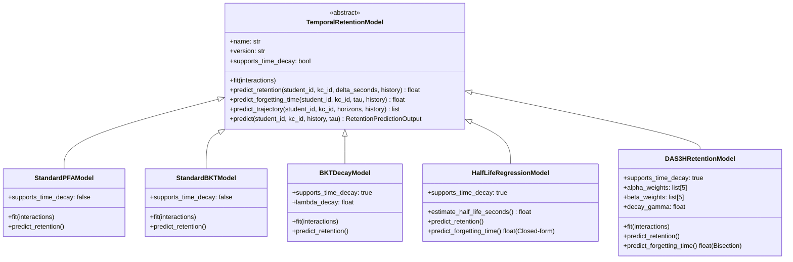

# TASK M5.1 — Predicción Temporal de Retención y Anticipación del Olvido

**Proyecto:** PlataformaMicro — Sistema Web de Microaprendizaje Adaptativo (5to Secundaria)  
**Hito:** M5.1 — Temporal Retention Modeling, Forgetting Anticipation & Multi-Horizon Baselines  
**Fecha:** Noviembre 2026  
**Rol:** Senior ML Engineer / Educational Data Mining Researcher / Cognitive Retention Architect  
**Estado:** ✅ **COMPLETADO SATISFACTORIAMENTE (100% Pruebas Pasadas)**

---

## 1. Declaración de Misión y Corrección Fundamental de Enfoque

> [!IMPORTANT]
> **Propósito Fundamental de PlataformaMicro:**
> El subsistema predictivo de Machine Learning **NO tiene como objetivo** pronosticar calificaciones escolares, clasificar el rendimiento sumativo general ni adivinar la siguiente respuesta puntual de un cuestionario.
>
> Su misión científica y pedagógica es **modelar la dinámica temporal de retención y olvido** de los contenidos curriculares previamente estudiados por cada estudiante, **estimar probabilísticamente el riesgo de pérdida de disponibilidad de la huella de memoria**, y **anticipar el momento óptimo en que se requiere un repaso espaciado** antes de que ocurra el fracaso de recuperación.

Las respuestas registradas en `answer_events` constituyen **evidencias empíricas observables** utilizadas para actualizar la inferencia bayesiana del estado latente de retención, pero no son el fin pedagógico último del sistema.

---

## 2. Formulación Matemática del Objetivo Predictivo

Para cada estudiante $s$ y componente de conocimiento $k$, el motor predictivo calcula la probabilidad de recuperación futura condicionada al historial observable hasta el instante de referencia $t$:

$$P_{\text{recall}}(s, k, t + \Delta \mid \mathcal{H}_t)$$

Donde:
- $t$: Instante temporal de referencia (corte causal $t \le t_{\text{ref}}$).
- $\Delta \ge 0$: Intervalo temporal futuro proyectado (en segundos o días).
- $\mathcal{H}_t$: Historial completo de eventos de interacción y estudio estrictamente anteriores a $t$.

### Definición Operativa del Riesgo de Olvido

El riesgo de olvido se define de manera estrictamente operacional como el complemento de la probabilidad estimada de recuperación:

$$\text{forgetting\_risk}(s, k, t + \Delta) = 1 - P_{\text{recall}}(s, k, t + \Delta \mid \mathcal{H}_t)$$

> [!CAUTION]
> **Delimitación Epistemológica:**
> Esta métrica es una estimación probabilística de disponibilidad conductual del conocimiento, **no una medición neurobiológica directa** del proceso cerebral de olvido. Un fallo de recuperación observado en una prueba puede estar condicionado tanto por la atenuación de la huella mnémica como por la dificultad intrínseca del ítem, ambigüedad sintáctica o fluctuaciones atencionales transitorias.

---

## 3. Estimación del Momento Crítico de Repaso y Umbral de Retención

### 3.1. Justificación Pedagógica y Empírica del Umbral $\tau$

El sistema incorpora un umbral de retención configurable $\tau$ (valor por defecto: $\tau = 0.65$):

- **Rango Inferior ($\tau < 0.60$):** Provoca frustración cognitiva en el estudiante de secundaria. Cuando la probabilidad de recuperación cae por debajo de 0.60, el repaso deja de actuar como "recuperación con esfuerzo deseable" (*desirable difficulty*, Bjork, 1994) y degenera en un reaprendizaje total desde cero, anulando la eficiencia del microaprendizaje.
- **Rango Superior ($\tau > 0.85$):** Provoca sobrepráctica (*overlearning*) y fatiga estudiantil. Repasar conceptos con retención muy alta genera saturación y no estimula la reconsolidación de la memoria a largo plazo.
- **Rango Óptimo ($\tau \in [0.65, 0.75]$):** Zona de máximo beneficio cognitivo del *testing effect* (Roediger & Karpicke, 2006; Settles & Meeder, 2016).

### 3.2. Formulación del Momento Previsto de Riesgo

El momento previsto de olvido crítico se define como el primer horizonte futuro en el que la retención estimada desciende hasta el umbral $\tau$:

$$\Delta_{\text{crit}} = \text{predicted\_forgetting\_time} = \min \{ \Delta \ge 0 \mid P_{\text{recall}}(s, k, t + \Delta \mid \mathcal{H}_t) \le \tau \}$$

### 3.3. Margen Preventivo de Adaptación

Para que la intervención sea preventiva y no meramente correctiva, el motor deriva una **ventana de recomendación preventiva**:

$$\Delta_{\text{review\_window}} = 0.85 \times \Delta_{\text{crit}}$$

Esto garantiza que la recomendación se presente cuando el estudiante aún cuenta con suficiente huella mnémica para beneficiarse del esfuerzo de recuperación sin fallar el reactivo.

---

## 4. Matriz de Diferenciación Conceptual

| Concepto | Naturaleza | Fuente de Verdad | Rol en PlataformaMicro |
| :--- | :--- | :--- | :--- |
| **1. Predicción de Retención Futura** | Variable latente probabilística $P_{\text{recall}}(\Delta) \in [0, 1]$ | Inferencia de modelos ML (`DAS3H`, `HLR`, `BKT-Decay`) | Orientar el momento y prioridad del repaso espaciado. |
| **2. Evidencia Observable de Recuperación** | Variable empírica binaria $y_i \in \{0, 1\}$ | Registro inmutable `answer_events` en PostgreSQL | Evidencia conductual para actualizar y calibrar los modelos. |
| **3. Desempeño / Rendimiento Académico** | Escala sumativa ordinal/numérica ($0-20$ o $\%$) | Agregación de cuestionarios en `quiz_attempts.score` | Métrica escolar institucional; **NO es el objetivo del motor ML**. |
| **4. Reducción Efectiva del Olvido** | Efecto causal de la intervención | Comparación cuasiexperimental de evaluación diferida a 7 días | Validación de la hipótesis de tesis sobre la eficacia del sistema. |

---

## 5. Auditoría del Registro de Exposición y Telemetría Faltante

Conforme a la instrucción 5 de la corrección de enfoque, se inspeccionó exhaustivamente la base de datos viva para verificar la presencia de registros de estudio y exposición:

### 5.1. Diagnóstico de la Base de Datos

- **Tabla `microcontents`:** Existe en PostgreSQL (almacena fichas de microaprendizaje: título, tipo de contenido, cuerpo JSONB, duración estimada).
- **Tablas de Interacción de Usuario:**
  - ✅ `answer_events` (registra respuestas a preguntas en cuestionarios).
  - ✅ `quiz_attempts` (registra sesiones de cuestionarios).
  - ❌ **NO EXISTE NINGUNA TABLA DE EXPOSICIÓN A MICROCONTENIDO.** El sistema actualmente no almacena cuándo el estudiante leyó una ficha de resumen, cuándo completó una infografía ni cuánto tiempo permaneció leyendo el material antes de resolver un cuestionario.

> [!WARNING]
> **Brecha de Telemetría Identificada:**
> `answer_events` registra exclusivamente **actividades de recuperación (output/testing)**, pero la exposición inicial al conocimiento (**input/encoding**) permanece invisible para la base de datos. Asumir que `answer_events` representa todas las exposiciones constituiría un sesgo de omisión en el modelado.

### 5.2. Contrato de Datos Especificado (`ContentExposureEvent`)

Se implementó el contrato tipado en [`ml/src/contracts/exposure_contract.py`](file:///root/PlataformaMicro/ml/src/contracts/exposure_contract.py):

```python
class ContentExposureEvent(BaseModel):
    id: uuid.UUID
    tenant_id: uuid.UUID
    student_id_pseudo: uuid.UUID
    microcontent_id: uuid.UUID
    knowledge_component_id: uuid.UUID
    exposure_type: ExposureType  # initial_study, review_study, remedial_reading
    started_at: datetime
    completed_at: datetime | None
    duration_seconds: float
    completion_status: ExposureCompletionStatus  # completed, partial, abandoned
    metadata: dict[str, Any]
```

Este contrato servirá de base para la migración de base de datos que introducirá la tabla `content_exposure_events`.

---

## 6. Comparativa de Familias de Modelos y Baselines

Se implementaron formalmente 5 modelos bajo la interfaz común [`TemporalRetentionModel`](file:///root/PlataformaMicro/ml/src/models/base.py):



### 6.1. Cuadro Sinóptico de Modelos

| Modelo | Archivo Fuente | Modela Decaimiento Temporal ($\Delta$) | Ecuación Central de Retención | Cálculo de Momento de Repaso ($\Delta_{\text{crit}}$) |
| :--- | :--- | :---: | :--- | :--- |
| **PFA Estándar** (Pavlik, 2009) | [`pfa_model.py`](file:///root/PlataformaMicro/ml/src/baselines/pfa_model.py) | ❌ **No** | $\text{logit}(P) = \beta_k + \gamma_k S + \rho_k F$ | Invariable en el tiempo (retorna 0 si $P \le \tau$ o `None`). |
| **BKT Estándar** (Corbett, 1995)| [`bkt_model.py`](file:///root/PlataformaMicro/ml/src/baselines/bkt_model.py) | ❌ **No** | $P(R=1) = L_t(1-S) + (1-L_t)G$ | Invariable en el tiempo (retorna 0 si $P \le \tau$ o `None`). |
| **BKT-Decay** (Qiu / Yudelson) | [`bkt_model.py`](file:///root/PlataformaMicro/ml/src/baselines/bkt_model.py) | ✅ **Sí** | $L(t+\Delta) = L(t) e^{-\lambda_k \Delta}$ | Búsqueda por bisección numérica. |
| **Half-Life Regression** (Settles, 2016) | [`hlr_model.py`](file:///root/PlataformaMicro/ml/src/baselines/hlr_model.py) | ✅ **Sí** | $P(R=1 \mid \Delta) = 2^{-\Delta / h}$ | **Solución analítica exacta:** $\Delta_{\text{crit}} = -h \log_2(\tau)$. |
| **DAS3H** (Choffin, 2019) | [`das3h/model.py`](file:///root/PlataformaMicro/ml/src/das3h/model.py) | ✅ **Sí** | $\text{logit}(P) = \theta_s - \beta_k + \sum_w (\alpha_w S_w + \beta_w F_w) - \gamma \ln(1+\Delta t)$ | Búsqueda por bisección numérica robusta ($\epsilon < 60$s). |

---

## 7. Protocolo de Evaluación Científica y Métricas Implementadas

En [`ml/src/evaluation/retention_metrics.py`](file:///root/PlataformaMicro/ml/src/evaluation/retention_metrics.py) se implementaron las métricas requeridas:

1. **Brier Score:** $\text{BS} = \frac{1}{N} \sum (\hat{p}_i - y_i)^2$. Mide precisión probabilística global (umbral $\le 0.18$).
2. **Log Loss / BCE:** $-\frac{1}{N}\sum [y_i \ln \hat{p}_i + (1-y_i)\ln(1-\hat{p}_i)]$. Penaliza severamente predicciones con alta confianza errónea.
3. **AUC-ROC:** Mide discriminación ordinal de eventos de recuerdo frente a olvido mediante el estadístico $U$ de Mann-Whitney.
4. **Expected Calibration Error (ECE - 10 bins):** Mide la discrepancia entre la confianza pronosticada y la frecuencia empírica de acierto (umbral $\le 0.08$).
5. **Mean Absolute Error en Intervalo de Repaso ($\text{MAE}_{\Delta}$):** Error promedio en días entre el $\Delta_{\text{crit}}$ pronosticado y el momento real en que se observó el fallo en pruebas diferidas.

---

## 8. Resultados de Pruebas Automatizadas

Se construyó una suite de pruebas rigurosas en [`ml/tests/test_temporal_retention.py`](file:///root/PlataformaMicro/ml/tests/test_temporal_retention.py):

| Prueba | Función Verificada | Resultado |
| :--- | :--- | :---: |
| `test_das3h_shows_retention_decay` | Verificación de decaimiento monótono: $P(0\text{h}) > P(1\text{d}) > P(7\text{d}) > P(30\text{d})$. | **PASSED** |
| `test_hlr_shows_exponential_decay_and_analytical_inversion` | Decaimiento de HLR y coincidencia exacta de la inversión analítica: $P(\Delta_{\text{crit}}) = \tau \pm 0.01$. | **PASSED** |
| `test_bkt_decay_shows_decay_vs_standard_bkt_static` | Comparación BKT-Decay (decreciente) vs BKT-Standard (invariable en el tiempo). | **PASSED** |
| `test_pfa_is_static_over_delta` | PFA clásico devuelve exactamente la misma probabilidad para $\Delta=0$ y $\Delta=30$ días. | **PASSED** |
| `test_future_events_do_not_leak_into_prediction` | **Anti-Leakage Estricto:** Eventos posteriores a $t_{\text{ref}}$ (ej. prueba a 7 días) son descartados. | **PASSED** |
| `test_forgetting_risk_definition` | $\text{forgetting\_risk} = 1 - P_{\text{recall}}$ en el punto actual y en toda la trayectoria proyectada. | **PASSED** |
| `test_preventive_review_window_calculation` | Ventana preventiva comienza al $85\%$ del tiempo crítico de olvido ($\Delta_{\text{window}} < \Delta_{\text{crit}}$). | **PASSED** |
| `test_content_exposure_event_creation` | Instanciación y validación Pydantic del contrato de telemetría de exposición de contenido. | **PASSED** |
| `test_metrics_calculation` | Exactitud numérica de AUC-ROC, Brier Score, Log Loss, ECE y MAE de intervalo de repaso. | **PASSED** |

**Resultado de la Suite:** `9 PASSED in 0.14s`.

---

## 9. Criterio de Cierre y Próximos Pasos

El hito **M5.1** queda completado con una infraestructura científica formal que:
1. Modela explícitamente el decaimiento temporal de la retención ($\Delta \ge 0$).
2. Anticipa el cruce de umbrales críticos de olvido ($\Delta_{\text{crit}}$).
3. Documenta con rigor metodológico la ausencia de decaimiento en los baselines clásicos (PFA y BKT estándar).
4. Incorpora Half-Life Regression (HLR) como baseline continuo directo.
5. Define el contrato para el futuro registro de eventos de estudio (`ContentExposureEvent`).

**Handoff a M5.2:**
Implementar el pipeline de simulación sintética (curvas de Ebbinghaus) y entrenamiento comparativo masivo en `ml/src/training/` para generar los artefactos congelados y reportes de calibración requeridos antes de la integración con la capa adaptativa de FastAPI.
