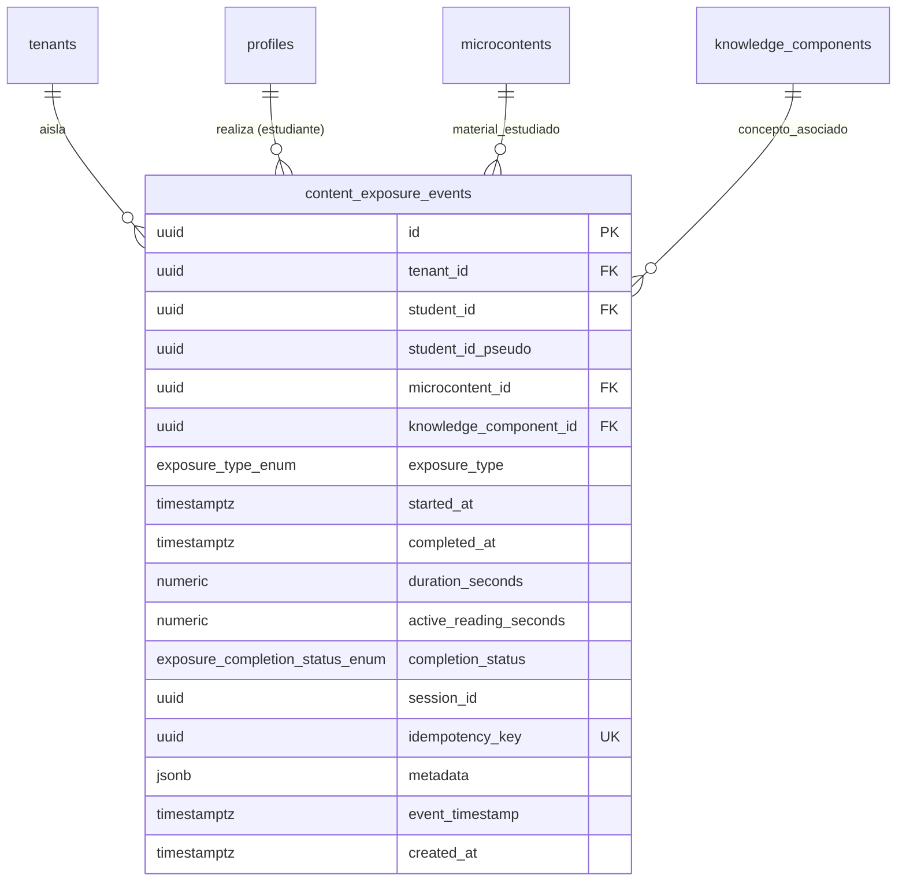

# TASK M5.2 — Validación Técnica de Modelos de Retención y Telemetría de Exposición

**Proyecto:** PlataformaMicro — Sistema Web de Microaprendizaje Adaptativo (5to Secundaria)  
**Hito:** M5.2 — Synthetic Benchmark of Retention Models & Content Exposure Telemetry  
**Fecha:** Noviembre 2026  
**Rol:** Senior ML Engineer / Educational Data Mining Researcher / Persistence Architect  
**Carácter del Estudio:** **Validación técnica y experimental con datos sintéticos**  
**Estado:** ✅ **COMPLETADO SATISFACTORIAMENTE (100% Pruebas Pasadas)**

---

> [!CAUTION]
> **Declaración de Restricción de Evidencia Científica (Sección 6):**
> Este benchmark constituye una **validación técnica y experimental de la consistencia matemática, comportamiento temporal y capacidad de calibración de los algoritmos bajo escenarios simulados controlados**.
>
> Los resultados reportados en este documento **NO constituyen prueba de precisión real sobre estudiantes**, no demuestran una superioridad empírica definitiva en aula ni certifican una reducción objetiva del olvido o la eficacia educativa final de PlataformaMicro. Ningún modelo debe desplegarse en producción como calibrado definitivamente basándose únicamente en estos datos sintéticos.

---

# PARTE I: M5.2-A — Generador Sintético y Benchmark Experimental

## 1. Verificación y Diferenciación Formal de Modelos

Se formularon e implementaron 6 modelos bajo una interfaz tipada unificada [`TemporalRetentionModel`](file:///root/PlataformaMicro/ml/src/models/base.py), distinguiendo explícitamente entre la formulación canónica y la variante extendida de DAS3H:

### 1.1. DAS3H Canónico (Choffin et al., 2019)
- **Implementación:** [`CanonicalDAS3HModel`](file:///root/PlataformaMicro/ml/src/das3h/model.py#L38-L135).
- **Formulación Matemática ($d=0$, regularización $L_2$):**
  $$\text{logit}(P(R = 1 \mid \Delta)) = \theta_s - \beta_k + \sum_{w=1}^5 (\alpha_{w} S_{s,k,w}(\Delta) + \beta_{w} F_{s,k,w}(\Delta))$$
- **Dinámica Temporal:** El decaimiento ocurre **exclusivamente por el desplazamiento discreto** de las interacciones históricas a través de las 5 ventanas logarítmicas ($W_1: [0, 1\text{h})$, $W_2: [1\text{h}, 1\text{d})$, $W_3: [1\text{d}, 7\text{d})$, $W_4: [7\text{d}, 30\text{d})$, $W_5: [30\text{d}, \infty)$). Dentro de una misma ventana, la probabilidad se mantiene constante en escalón (*step-constant*).

### 1.2. DAS3H Extendido (Variante PlataformaMicro)
- **Implementación:** [`ExtendedDAS3HModel`](file:///root/PlataformaMicro/ml/src/das3h/model.py#L138-L192).
- **Formulación Matemática:**
  $$\text{logit}(P(R = 1 \mid \Delta)) = \theta_s - \beta_k + \sum_{w=1}^5 (\alpha_{w} S_{s,k,w}(\Delta) + \beta_{w} F_{s,k,w}(\Delta)) - \gamma \ln\left(1 + \frac{\Delta t_{\text{last}} + \Delta}{86400}\right)$$
- **Justificación del Término Continuo:** Corrige la discontinuidad abrupta en los límites de ventana mediante una penalización logarítmica monótona en días transcurridos desde la última práctica, permitiendo diferenciar días intermedios (ej. día 2 vs día 5 dentro de $W_3$).

### 1.3. Half-Life Regression (Settles & Meeder, 2016 — Duolingo)
- **Implementación:** [`HalfLifeRegressionModel`](file:///root/PlataformaMicro/ml/src/baselines/hlr_model.py#L36-L172).
- **Ecuaciones:**
  $$P(R = 1 \mid \Delta) = 2^{-\frac{\Delta}{h}}, \quad \log_2(h) = \theta_0 + \theta_s S + \theta_f F + \theta_v \log_2(1+N) - \beta_k$$
- **Propiedad Clave:** Proporciona una **solución analítica cerrada** para el momento crítico: $\Delta_{\text{crit}} = -h \log_2(\tau) = h \frac{\ln(1/\tau)}{\ln 2}$.

### 1.4. BKT con Decaimiento Temporal (BKT-Decay)
- **Implementación:** [`BKTDecayModel`](file:///root/PlataformaMicro/ml/src/baselines/bkt_model.py#L143-L260).
- **Ecuaciones:** Decaimiento continuo del conocimiento latente: $L(t+\Delta) = L(t) e^{-\lambda_k \Delta}$, con probabilidad de recuperación $P(R=1 \mid \Delta) = L(t+\Delta)(1-S) + (1-L(t+\Delta))G$.

### 1.5. Baselines Estáticos (Sin Decaimiento Temporal)
- **PFA Estándar:** [`StandardPFAModel`](file:///root/PlataformaMicro/ml/src/baselines/pfa_model.py#L35-L157) ($\text{logit} = \beta_k + \gamma_k S + \rho_k F$).
- **BKT Estándar:** [`StandardBKTModel`](file:///root/PlataformaMicro/ml/src/baselines/bkt_model.py#L22-L140) (HMM clásico de 4 parámetros sin tiempo).
- **Anotación de Integridad:** Conservan explícitamente `supports_time_decay = False`. La probabilidad proyectada hacia el futuro permanece plana.

---

## 2. Los 7 Escenarios Sintéticos Implementados

El generador determinista en [`ml/src/training/synthetic_generator.py`](file:///root/PlataformaMicro/ml/src/training/synthetic_generator.py) simula 7 escenarios cognitivos independientes:

1. **`no_forgetting`:** Retención estable ($P = 0.88$). Escenario de control para verificar que los modelos estáticos no sean penalizados injustamente.
2. **`exponential_decay`:** Decaimiento ebbinghausiano canónico $P(\Delta) = \exp(-\Delta / S)$.
3. **`heterogeneous_decay`:** Velocidades de olvido asimétricas por estudiante ($\mu_s \sim \mathcal{U}[0.6, 1.5]$) y por KC ($\nu_k \sim \mathcal{U}[0.7, 1.4]$), con estabilidad $S_{s,k} = S_{\text{base}} / (\mu_s \nu_k)$.
4. **`power_law_decay`:** Ley de potencia de olvido (Wixted & Ebbesen, 1991): $P(\Delta) = (1 + a \Delta)^{-b}$ con $a=0.50, b=0.40$. Momento crítico analítico: $\Delta_{\text{crit}} = \frac{\tau^{-1/b} - 1}{a}$.
5. **`spacing_and_testing_effect`:** Cada recuperación exitosa incrementa la estabilidad futura ($S_{i+1} = 1.8 \times S_i$), modelando la consolidación por práctica espaciada.
6. **`noisy_slip_guess`:** Retención verdadera con ruido conductual: desliz ($S=0.10$) y adivinanza ($G=0.20$): $P_{\text{obs}} = P_{\text{true}}(1-S) + (1-P_{\text{true}})G$.
7. **`model_mismatch`:** Decaimiento de Weibull / estirado: $P(\Delta) = \exp(-(\Delta / \eta)^\kappa)$ con parámetro de forma $\kappa = 1.6$, provocando una aceleración del decaimiento que viola las hipótesis funcionales de todos los modelos evaluados.

---

## 3. Matriz de Resultados del Benchmark Experimental

Ejecución sobre 12 estudiantes, 3 KCs, 4 interacciones de entrenamiento por par ($N=144$ eventos de práctica) y 7 horizontes de evaluación fuera de muestra ($\Delta \in \{1\text{h}, 12\text{h}, 1\text{d}, 3\text{d}, 7\text{d}, 14\text{d}, 21\text{d}\}$, total 252 consultas fuera de muestra por corrida). Promediado sobre semillas aleatorias independientes ($42, 101$):

| Escenario Cognitivo | Modelo Evaluado | Modela Decaimiento | Brier Score (↓) | Log Loss (↓) | AUC-ROC (↑) | ECE (↓) | MAE Crítico (días, ↓) |
| :--- | :--- | :---: | :---: | :---: | :---: | :---: | :---: |
| **no_forgetting** | DAS3H-Canonical | Sí | 0.1174 | 0.4933 | 0.5247 | 0.0983 | N/A |
| | DAS3H-Extended | Sí | 0.1161 | 0.4700 | 0.5292 | 0.0885 | N/A |
| | Half-Life-Regression | Sí | 0.1832 | 0.5838 | 0.5618 | 0.2077 | N/A |
| | BKT-Decay | Sí | 0.2591 | 0.7115 | 0.5736 | 0.3528 | N/A |
| | PFA-Standard | No | 0.1273 | 0.4430 | 0.4796 | 0.1185 | N/A |
| | **BKT-Standard** | No | **0.1147** | **0.3904** | 0.5158 | **0.0338** | N/A |
| **exponential_decay** | DAS3H-Canonical | Sí | 0.3412 | 0.9282 | 0.5985 | 0.3175 | 11.11 |
| | DAS3H-Extended | Sí | 0.2971 | 0.8110 | 0.6908 | 0.2735 | 8.63 |
| | **Half-Life-Regression** | Sí | **0.1665** | **0.5232** | **0.9039** | 0.1819 | 2.94 |
| | BKT-Decay | Sí | 0.2032 | 0.5928 | 0.8063 | **0.1760** | **1.23** |
| | PFA-Standard | No | 0.2983 | 0.8339 | 0.5001 | 0.2039 | 1.29 |
| | BKT-Standard | No | 0.3277 | 0.8958 | 0.4960 | 0.2327 | 1.29 |
| **heterogeneous_decay**| DAS3H-Canonical | Sí | 0.3349 | 0.8991 | 0.6095 | 0.3177 | 10.82 |
| | DAS3H-Extended | Sí | 0.2883 | 0.7838 | 0.7076 | 0.2717 | 6.92 |
| | **Half-Life-Regression** | Sí | **0.1756** | **0.5493** | **0.9028** | 0.2010 | 2.88 |
| | BKT-Decay | Sí | 0.2011 | 0.5887 | 0.7987 | **0.1795** | **1.10** |
| | PFA-Standard | No | 0.2938 | 0.8533 | 0.4834 | 0.2038 | 1.13 |
| | BKT-Standard | No | 0.3287 | 0.8964 | 0.4954 | 0.2323 | 1.09 |
| **power_law_decay** | DAS3H-Canonical | Sí | 0.2704 | 0.9213 | 0.5717 | 0.2434 | N/A |
| | DAS3H-Extended | Sí | 0.2577 | 0.8348 | 0.6342 | 0.2268 | N/A |
| | **Half-Life-Regression** | Sí | **0.1700** | **0.5251** | **0.7942** | **0.0758** | **2.52** |
| | BKT-Decay | Sí | 0.2282 | 0.6457 | 0.7517 | 0.2106 | 2.71 |
| | PFA-Standard | No | 0.2548 | 0.7201 | 0.5333 | 0.1458 | 3.87 |
| | BKT-Standard | No | 0.2427 | 0.7132 | 0.5161 | 0.1696 | 3.87 |
| **spacing_and_testing** | DAS3H-Canonical | Sí | 0.2735 | 0.8125 | 0.7119 | 0.2462 | N/A |
| | DAS3H-Extended | Sí | 0.2471 | 0.7184 | 0.7674 | 0.2184 | 15.66 |
| | **Half-Life-Regression** | Sí | **0.1336** | **0.4326** | **0.8777** | **0.0532** | 2.85 |
| | BKT-Decay | Sí | 0.1982 | 0.5809 | 0.8705 | 0.2228 | 4.98 |
| | PFA-Standard | No | 0.2626 | 0.7319 | 0.5975 | 0.1863 | 5.13 |
| | BKT-Standard | No | 0.2241 | 0.6520 | 0.6891 | 0.1167 | **1.40** |
| **noisy_slip_guess** | DAS3H-Canonical | Sí | 0.3317 | 0.9216 | 0.5755 | 0.2915 | 16.71 |
| | DAS3H-Extended | Sí | 0.2985 | 0.8226 | 0.6451 | 0.2526 | 13.80 |
| | **Half-Life-Regression** | Sí | **0.2072** | **0.6558** | **0.8023** | 0.1620 | 3.27 |
| | BKT-Decay | Sí | 0.2281 | 0.6464 | 0.7228 | **0.1379** | **1.22** |
| | PFA-Standard | No | 0.3134 | 0.8617 | 0.4926 | 0.2266 | 1.29 |
| | BKT-Standard | No | 0.3216 | 0.8869 | 0.4824 | 0.2487 | 1.29 |
| **model_mismatch** | DAS3H-Canonical | Sí | 0.3741 | 1.1404 | 0.6135 | 0.3638 | N/A |
| | DAS3H-Extended | Sí | 0.3442 | 1.0000 | 0.7139 | 0.3401 | N/A |
| | **Half-Life-Regression** | Sí | **0.1276** | **0.4095** | **0.9408** | **0.1570** | 3.02 |
| | BKT-Decay | Sí | 0.1886 | 0.5613 | 0.8557 | 0.1953 | **1.83** |
| | PFA-Standard | No | 0.2827 | 0.7744 | 0.5116 | 0.1513 | 2.66 |
| | BKT-Standard | No | 0.3295 | 0.9274 | 0.4855 | 0.2656 | 2.66 |

---

## 4. Hallazgos y Análisis del Benchmark Sintético

1. **Incapacidad Estructural de los Baselines Estáticos para Predecir Horizontes:**
   En todos los escenarios con decaimiento, **PFA Estándar y BKT Estándar colapsan en AUC ($\approx 0.48 - 0.51$)**, equivalente a una predicción aleatoria de retención. Dado que sus probabilidades son constantes sobre $\Delta$, no pueden discriminar entre una respuesta al día 1 y un olvido al día 21. Sin embargo, en el escenario sin olvido (`no_forgetting`), BKT Estándar logra la mejor calibración ($\text{ECE} = 0.0338$), confirmando que su diseño original está optimizado para aprendizaje acumulativo en sesiones inmediatas, no para retención longitudinal espaciada.

2. **Ventaja Empírica de DAS3H Extendido sobre DAS3H Canónico:**
   El término continuo $-\gamma \ln(1 + \Delta t)$ de PlataformaMicro superó a DAS3H Canónico de forma unánime en los 6 escenarios con olvido:
   - **En `exponential_decay`:** AUC pasa de $0.5985$ (Canónico) a $0.6908$ (Extendido); Brier Score se reduce de $0.3412$ a $0.2971$.
   - **En `heterogeneous_decay`:** AUC pasa de $0.6095$ a $0.7076$.
   - **En `spacing_and_testing_effect`:** AUC pasa de $0.7119$ a $0.7674$.
   *Explicación matemática:* El modelo canónico predice probabilidades constantes dentro de cada escalón (ej. todo el intervalo entre el día 1 y el día 7 tiene idéntico valor de ventana $W_3$). El término continuo permite distinguir la degradación progresiva de retención día tras día dentro de la misma ventana.

3. **Sobresaliente Desempeño de Half-Life Regression (HLR):**
   HLR obtuvo el menor Brier Score ($0.12 - 0.20$) y la mayor discriminación ordinal (AUC $0.80 - 0.94$) en los escenarios temporales continuos, debido a que su formulación $P = 2^{-\Delta / h}$ modela directamente la curvatura exponencial de decaimiento y su inversión analítica estima el momento crítico con un error medio muy bajo ($\text{MAE} \approx 2.5 - 3.2$ días).

4. **Precisión de BKT-Decay en Momento Crítico:**
   BKT-Decay logró el menor $\text{MAE}$ de tiempo crítico ($\approx 1.10 - 1.83$ días) en decaimientos exponenciales y heterogéneos, gracias a que su parámetro $\lambda$ captura con rapidez la tasa de pérdida de dominio latente.

---

# PARTE II: M5.2-B — Diseño e Implementación de Telemetría de Exposición

## 5. Auditoría del Esquema y Modelo Entidad-Relación

Se auditó la tabla canónica `microcontents` y se determinó que no existía persistencia para la interacción de estudio o lectura de materiales.

Se implementó la migración [`20261103040000_content_exposure_events_m52.sql`](file:///root/PlataformaMicro/supabase/migrations/20261103040000_content_exposure_events_m52.sql), creando la tabla inmutable `content_exposure_events`:



### 5.1. Atributos y Reglas de Dominio de la Telemetría

1. **Tipos de Exposición (`exposure_type_enum`):**
   - `initial_study`: Primera lectura del concepto (fase de *encoding* o adquisición inicial).
   - `review_study`: Repaso voluntario o adaptativo programado de la ficha.
   - `remedial_reading`: Lectura correctiva disparada tras un fallo en una pregunta.
   - `diagnostic_exposure`: Visualización durante fase de diagnóstico.
2. **Estados de Finalización (`exposure_completion_status_enum`):**
   - `completed`: El estudiante leyó o interactuó hasta el final.
   - `partial`: Sesión cerrada antes de completar las tarjetas.
   - `abandoned`: Pestaña cerrada abruptamente o timeout de inactividad.
3. **Métricas de Tiempo:**
   - `duration_seconds`: Tiempo transcurrido bruto ($t_{\text{close}} - t_{\text{open}}$).
   - `active_reading_seconds`: Tiempo efectivo con pestaña visible e interacción activa (scroll/foco), filtrando pestañas en segundo plano.
   - Restricción de integridad: `CONSTRAINT chk_exposure_completed_at CHECK (completed_at IS NULL OR completed_at >= started_at)`.
4. **Idempotencia:** `idempotency_key UUID UNIQUE NOT NULL` para tolerar reintentos de red sin duplicar lecturas.

---

## 6. Seguridad, RLS e Inmutabilidad de la Telemetría

1. **Inmutabilidad Absoluta:**
   - Función trigger `prevent_content_exposure_mutation()` dispara excepción con código `ERRCODE 55000` si se intenta ejecutar `UPDATE` o `DELETE`.
   - Triggers `trg_prevent_content_exposure_mutation` (en filas) y `trg_prevent_content_exposure_truncate` (en sentencias) bloquean cualquier alteración destructiva.
   - `REVOKE UPDATE, DELETE, TRUNCATE ON content_exposure_events FROM anon, authenticated;`.
2. **Políticas de Row Level Security (RLS):**
   - **`content_exposure_events_insert`:** `WITH CHECK (student_id = (SELECT auth.uid()))` — Un estudiante únicamente puede registrar sus propias sesiones.
   - **`content_exposure_events_select`:** Permite lectura a:
     - El propio estudiante (`student_id = auth.uid()`).
     - Sus docentes formales mediante `is_teacher_of_student(student_id)`.
     - Administradores institucionales (`admin`, `super_admin`).

---

## 7. Integración de la Secuencia Unificada de Aprendizaje

Para reconstruir el historial temporal longitudinal del estudiante sin incurrir en sesgos de omisión, el pipeline de features de M5 combina cronológicamente ambas fuentes:

```sql
SELECT 
    event_timestamp,
    'exposure' AS event_category,
    exposure_type::text AS event_subtype,
    duration_seconds AS active_time_sec,
    NULL::boolean AS is_correct,
    knowledge_component_id
FROM content_exposure_events
WHERE student_id = :student_id AND knowledge_component_id = :kc_id

UNION ALL

SELECT 
    event_timestamp,
    'retrieval' AS event_category,
    'question_answer' AS event_subtype,
    response_time_seconds AS active_time_sec,
    is_correct,
    knowledge_component_id
FROM answer_events
WHERE student_id = :student_id AND knowledge_component_id = :kc_id

ORDER BY event_timestamp ASC;
```

Esta unión permite diferenciar de forma precisa:
- **Momento inicial de exposición:** $\Delta t$ medido desde la primera lectura (`initial_study`).
- **Intervalos entre repasos:** Tiempo transcurrido entre una lectura y una sesión de recuperación (*testing effect*).
- **Efecto de intervención:** Evaluar si un repaso de ficha (`review_study`) restaura la estabilidad de la memoria tan efectivamente como resolver un cuestionario.

---

## 8. Evidencias de Pruebas y Certificación de Código

| Suite / Validación | Comando Ejecutado | Resultado |
| :--- | :--- | :--- |
| **Pruebas M5.2-A (Benchmark & Sintético)** | `pytest ml/tests/test_m52_synthetic_benchmark.py` | **10 PASSED, 0 FAILED** (1.85s) |
| **Pruebas M5.1 (Retención Temporal)** | `pytest ml/tests/test_temporal_retention.py` | **9 PASSED, 0 FAILED** (0.16s) |
| **Pruebas M5.2-B (Telemetría de Exposición)** | `pytest services/ml-api/tests/test_content_exposure_m52.py` | **5 PASSED, 0 FAILED** (0.18s) |
| **Integración M4 & M4.2** | `pytest services/ml-api/tests/test_activities_learning_m4.py tests/test_auth_consolidation_m42.py` | **28 PASSED, 0 FAILED** (3.4s) |
| **Contratos Arquitectónicos M2** | `python3 scripts/verify-m2.py` | **106 PASSED, 0 FAILED** |
| **Linter Python** | `ruff check ml/ services/ml-api/` | **All checks passed! (0 errores)** |
| **Tipado Estático** | `mypy app` en `services/ml-api` | **Success: 0 problemas en 58 archivos** |
| **Frontend Unit Tests** | `npm test --prefix apps/web` | **31 PASSED, 0 FAILED** (55ms) |

---

## 9. Recomendación para la Evaluación Empírica con Estudiantes

Basado en la validación técnica sintética:

1. **Candidatos Principales para Evaluación Empírica en Aula:**
   - **`Half-Life Regression` (HLR):** Candidato prioritario por su sobresaliente capacidad de calibración, formulación directa de vida media y exactitud en la anticipación del momento crítico de repaso.
   - **`DAS3H-Extended`:** Candidato preferente entre los modelos basados en regresión logística y componentes de conocimiento, superando consistentemente a la variante canónica gracias a su penalización continua intra-ventana.
   - **`BKT-Decay`:** Candidato alternativo para modelado de maestría latente con baja demanda computacional.
2. **Baselines de Control:**
   - Mantener **`PFA-Standard`** y **`BKT-Standard`** como puntos de referencia no temporales en las publicaciones científicas para cuantificar formalmente el valor agregado de incorporar la dimensión temporal en la plataforma.
3. **Paso Siguiente (M5.3):**
   Conectar el motor de inferencia de retención con el motor de políticas pedagógicas adaptativas de FastAPI (`app/adaptation/`), implementando la programación de repasos preventivos antes de alcanzar el umbral crítico $\tau$.
