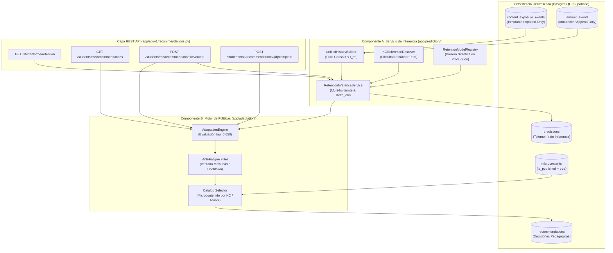

# TASK M5.3 — Servicio de Inferencia de Retención y Motor de Políticas Adaptativas

**Proyecto:** PlataformaMicro — Sistema Web de Microaprendizaje Adaptativo (5to Secundaria)  
**Hito:** M5.3 — Retention Inference Service & Pedagogical Adaptation Engine  
**Fecha:** Noviembre 2026  
**Rol:** Senior ML Engineer / Educational Data Mining Researcher / Backend Architect  
**Carácter del Componente:** **Servicio desacoplado de producción en FastAPI con persistencia relacional**  
**Estado:** ✅ **COMPLETADO SATISFACTORIAMENTE (100% Pruebas Pasadas)**

---

> [!IMPORTANT]
> **Alineación Pedagógica y Ética del Motor Adaptativo:**
> 1. **Objetivo de Retención vs Rendimiento Escolar:** El sistema no predice notas ni clasifica estudiantes con fines punitivos; su fin exclusivo es modelar la dinámica de olvido temporal por Componente de Conocimiento (KC) y programar repasos oportunos antes de que la probabilidad de recuperación caiga por debajo del umbral crítico $\tau = 0.650$.
> 2. **Salvaguarda Estricta en Producción:** Los modelos con metadatos `data_origin == "synthetic"` quedan **estrictamente bloqueados** en entornos `production` (`ENVIRONMENT == "production"`), retornando un estado transparente de `insufficient_empirical_data` y activando la política pedagógica determinista de respaldo (*rule-based fallback*).
> 3. **Política Anti-Fatiga de 24 Horas:** Para proteger la carga cognitiva de estudiantes de secundaria (16–17 años), la política adaptativa prohíbe emitir más de 1 recomendación de repaso para el mismo KC dentro de una ventana móvil de 24 horas y rechaza duplicados si ya existe una recomendación en estado `pending`.

---

# 1. Arquitectura General del Sistema

El Hito M5.3 consolida la integración entre los modelos predictivos longitudinales desarrollados en `ml/src/`, la base de datos relacional de Supabase y el microservicio FastAPI en `services/ml-api/`. La arquitectura separa estrictamente el **subsistema de inferencia temporal** del **motor de adaptación pedagógica**, garantizando cero acoplamiento con la generación por LLMs o interfaces de usuario.



---

# 2. Componente A: Servicio de Inferencia de Retención

Implementado en [`services/ml-api/app/prediction/`](file:///root/PlataformaMicro/services/ml-api/app/prediction/).

### 2.1. Reconstrucción Causal de la Línea de Aprendizaje ([`UnifiedHistoryBuilder`](file:///root/PlataformaMicro/services/ml-api/app/prediction/history_builder.py))
- **Consolidación Multifuente:** Agrega de forma transparente las exposiciones iniciales y repasos ([`content_exposure_events`](file:///root/PlataformaMicro/docs/architecture/content_exposure_telemetry.md)) con los eventos de evaluación y respuesta ([`answer_events`](file:///root/PlataformaMicro/docs/architecture/database-schema.md#L450)).
- **Causalidad Estricta Anti-Leakage:** La consulta SQL aplica un corte estricto `event_timestamp < reference_time`, garantizando matemáticamente que ningún evento futuro o simultáneo contamine el vector de entrada.
- **Desempate Determinista:** Las interacciones se ordenan con clave compuesta `(event_timestamp ASC, created_at ASC, id ASC)`, eliminando carreras en marcas de tiempo concurrentes.
- **Aislamiento Multitenant:** Filtro mandatorio por `student_id` y `tenant_id`.

### 2.2. Estandarización de Dificultad por Componente ([`KCReferenceResolver`](file:///root/PlataformaMicro/services/ml-api/app/prediction/kc_reference_resolver.py))
Para evitar que las variaciones accidentales de dificultad entre preguntas específicas de cuestionarios sesguen la estimación de retención global del concepto, se proyecta la dificultad canónica `difficulty_prior` ($p \in [0.05, 0.95]$) al espacio logit canónico del modelo:
$$\beta_k = \ln\left(\frac{p_k}{1 - p_k}\right)$$

### 2.3. Registro de Modelos y Salvaguarda de Producción ([`RetentionModelRegistry`](file:///root/PlataformaMicro/services/ml-api/app/prediction/model_registry.py))
El registro desacopla la carga física de artefactos y gobierna su disponibilidad según el entorno de ejecución:

| Estado de Disponibilidad (`ModelAvailabilityStatus`) | Condición de Activación | Comportamiento del Sistema |
| :--- | :--- | :--- |
| `EMPIRICAL_MODEL_READY` | Modelo empírico congelado con `data_origin == "empirical"` presente en disco. | Inferencia con modelo entrenado real. |
| `COLD_START` | Historial del estudiante en el KC $< 3$ interacciones formativas. | Fallback determinista basado en prior de dificultad sin inferencia individual. |
| `INSUFFICIENT_EMPIRICAL_DATA` | Entorno `production` sin modelo empírico validado en disco. | Bloqueo absoluto de modelos sintéticos. Fallback pedagógico por reglas. |
| `SYNTHETIC_TEST_MODE` | Entorno `development` o `test` con flag explícito `allow_synthetic_in_dev=True`. | Inferencia temporal para pruebas unitarias y de integración. |
| `MODEL_UNAVAILABLE` | Error de lectura o artefacto corrupto en disco. | Modo seguro degradado sin bloqueo del servicio HTTP. |

### 2.4. Proyecciones Multi-Horizonte y Tiempo Crítico de Olvido ([`RetentionInferenceService`](file:///root/PlataformaMicro/services/ml-api/app/prediction/inference_service.py))
Para cada KC evaluado, el servicio calcula:
1. **Probabilidad de retención actual:** $P_{\text{recall}}(t_{\text{ref}})$.
2. **Proyecciones discretas en tres horizontes normados:**
   - Corto plazo: $h = 24\text{ h}$ (1 día).
   - Mediano plazo: $h = 72\text{ h}$ (3 días).
   - Largo plazo: $h = 168\text{ h}$ (7 días).
3. **Nivel de riesgo operativo:**
   - `LOW` ($P \ge 0.80$): Retención consolidada.
   - `MODERATE` ($0.65 \le P < 0.80$): Umbral de observación preventiva.
   - `HIGH` ($P < 0.65$): Momento crítico para intervención de repaso.
4. **Tiempo crítico de olvido $\Delta_{\text{crit}}$:**
   $$\Delta_{\text{crit}} = \min \{\Delta \ge 0 \mid P_{\text{recall}}(t_{\text{ref}} + \Delta) \le \tau\}$$
5. **Ventana de repaso preventivo:**
   $$t_{\text{review}} = t_{\text{ref}} + 0.85 \cdot \Delta_{\text{crit}}$$
   *(Si la probabilidad ya se encuentra en o por debajo de $\tau$, $t_{\text{review}} = t_{\text{ref}}$, indicando refuerzo inmediato).*

### 2.5. Persistencia de Telemetría en Base de Datos
Cada ejecución persiste registros en la tabla `predictions` registrando: `input_event_cutoff`, `predicted_forgetting_time_seconds`, `tau_threshold`, `risk_level` y `prediction_status`.

---

# 3. Componente B: Motor de Políticas Adaptativas

Implementado en [`services/ml-api/app/adaptation/`](file:///root/PlataformaMicro/services/ml-api/app/adaptation/).

### 3.1. Reglas Pedagógicas de Decisión
La política evalúa individualmente el perfil de retención de cada KC frente a las siguientes condiciones:
1. **Criterio Predictivo Principal:**
   - Si $P_{\text{recall}} \le \tau$: Se activa necesidad urgente de repaso.
   - Si se proyecta que $P_{\text{recall}}$ cruzará el umbral en $\le 3$ días: Se activa repaso preventivo oportuno.
2. **Criterio de Respaldo por Arranque en Frío (*Cold-Start*):**
   - Si el estudiante cuenta con 1 o 2 interacciones registradas pero aún no alcanza el mínimo de inferencia ($N < 3$), se emite recomendación bajo método `rule_based_fallback` ("Consolidación inicial sugerida por regla pedagógica de respaldo").
   - Si el concepto no registra ninguna interacción formativa previa, no se satura al estudiante y se clasifica como `retention_sufficient` (sin actividad).
3. **Criterio en Producción sin Modelo Empírico:**
   - Se programa recomendación mediante calendario canónico espaciado con método `rule_based_fallback`.

### 3.2. Filtro Anti-Fatiga y Cooldown Móvil de 24 Horas
Para garantizar el bienestar estudiantil:
- **Límite de Frecuencia:** Ningún estudiante puede recibir más de una recomendación sobre el mismo KC dentro de un intervalo móvil de 24 horas:
  $$\text{cooldown\_window} = [t_{\text{now}} - 24\text{h}, t_{\text{now}}]$$
- **Supresión de Duplicados Pendientes:** Si el estudiante ya posee una recomendación en estado `pending` para ese KC, el motor rechaza crear una nueva y reporta `cooldown_active` con motivo descriptivo.

### 3.3. Selección de Catálogo de Microcontenidos
El motor localiza microcontenidos didácticos aprobados en PostgreSQL bajo los siguientes filtros estrictos:
- `knowledge_component_id = $kc_id`
- `tenant_id = $tenant_id` (aislamiento institucional)
- `is_published = true` (únicamente material verificado)
- Orden: `ORDER BY created_at ASC LIMIT 1` (material canónico fundamental).
- Si no existe material publicado disponible para ese KC, se registra la decisión `no_content_available` sin romper la ejecución.

### 3.4. Auditoría y Trazabilidad (*Decision Reason*)
Toda recomendación persistida en la tabla `recommendations` almacena:
- `selection_method`: `predictive_model` o `rule_based_fallback`.
- `policy_name`: `preventive_spaced_repetition`.
- `policy_version`: `1.0.0`.
- `decision_reason`: Explicación textual auditada con lenguaje pedagógico empático (ej. "Refuerzo sugerido para consolidar el concepto antes de perder retención").
- `cooldown_until`: Timestamp exacto hasta el cual queda bloqueada una nueva sugerencia para este KC.
- `idempotency_key`: UUID determinista para evitar inserciones duplicadas ante concurrencia de red.

---

# 4. Capa de Servicios REST (FastAPI)

Los endpoints residen en [`services/ml-api/app/api/v1/recommendations.py`](file:///root/PlataformaMicro/services/ml-api/app/api/v1/recommendations.py) y están protegidos mediante el mecanismo de autenticación consolidado en M4.2 (`get_current_user` vía Supabase JWT HS256):

```
GET  /api/v1/students/me/retention
GET  /api/v1/students/me/recommendations
POST /api/v1/students/me/recommendations/evaluate
POST /api/v1/students/me/recommendations/{id}/complete
```

### 4.1. `GET /api/v1/students/me/retention`
- **Roles permitidos:** `student`, `admin`, `super_admin`.
- **Query Params:** `knowledge_component_id` (opcional), `tau` (por defecto `0.650`).
- **Respuesta:** Resumen tipado con desglose de KCs, probabilidades actuales, proyecciones a 24h/72h/168h, estado del modelo (`COLD_START`, etc.) y fecha de corte causal.

### 4.2. `GET /api/v1/students/me/recommendations`
- **Roles permitidos:** `student`, `admin`, `super_admin`.
- **Query Params:** `include_completed` (booleano, por defecto `false`).
- **Respuesta:** Lista de tarjetas de recomendación con título del microcontenido, duración estimada en segundos, motivo pedagógico empático, estado y fecha límite de vigencia.

### 4.3. `POST /api/v1/students/me/recommendations/evaluate`
- **Roles permitidos:** `student`, `admin`, `super_admin`.
- **Comportamiento:** Dispara el ciclo completo de inferencia y evaluación adaptativa para los conceptos matriculados del alumno, aplicando el filtro de anti-fatiga de 24h e insertando nuevas recomendaciones si corresponde.

### 4.4. `POST /api/v1/students/me/recommendations/{id}/complete`
- **Roles permitidos:** `student`, `admin`, `super_admin`.
- **Comportamiento:** Marca la recomendación en estado `completed` y sella `completed_at = now()`.
- **Seguridad:** Valida tenencia y propiedad (`student_id = auth.uid()` y `tenant_id = current_user.tenant_id`). Si la recomendación no existe o pertenece a otro estudiante, retorna `404 Not Found`.

---

# 5. Base de Datos y Migración SQL

Migración aplicada satisfactoriamente en los entornos locales y de pruebas:  
[`supabase/migrations/20261103050000_recommendations_and_predictions_m53.sql`](file:///root/PlataformaMicro/supabase/migrations/20261103050000_recommendations_and_predictions_m53.sql).

### Modificaciones Clave del Esquema:
1. **Extensión de ENUM:** `recommendation_status_enum` enriquecido con el valor `'expired'`.
2. **Columnas en `predictions`:** `predicted_forgetting_time_seconds double precision`, `tau_threshold double precision DEFAULT 0.650`.
3. **Columnas en `recommendations`:**
   - `policy_name text NOT NULL DEFAULT 'preventive_spaced_repetition'`.
   - `policy_version text NOT NULL DEFAULT '1.0.0'`.
   - `scheduled_for timestamptz`.
   - `cooldown_until timestamptz`.
   - `completed_at timestamptz`.
   - `expires_at timestamptz`.
   - `idempotency_key uuid UNIQUE`.
4. **Índices de Alto Rendimiento:**
   - `idx_recommendations_student_kc_created` en `(student_id, knowledge_component_id, created_at DESC)`.
   - `idx_recommendations_student_status_pending` en `(student_id, status) WHERE status = 'pending'`.
   - `idx_predictions_student_kc_created` en `(student_id, knowledge_component_id, created_at DESC)`.
5. **Políticas de Seguridad Row Level Security (RLS):**
   - Inserción y actualización controlada en `recommendations` con aislamiento estricto por usuario y rol.
   - Inserción de telemetría en `predictions`.
   - Lectura pública/restringida en `model_versions`.

---

# 6. Certificación de Pruebas y Calidad de Código

El hito fue verificado de forma exhaustiva mediante suites de pruebas automatizadas y herramientas estáticas de análisis.

### 6.1. Resumen de Pruebas Automatizadas

```
================================================================================
SUITE                                  RESULTADO            TIEMPO
================================================================================
ml-api (Suite Completa M5.3 + Anteriores) 237 PASSED, 0 FAILED 39.36s
  - test_inference_and_adaptation_m53.py  9 PASSED, 0 FAILED   1.88s
  - test_content_exposure_m52.py          5 PASSED, 0 FAILED   0.98s
  - test_auth_consolidation_m42.py        9 PASSED, 0 FAILED   1.12s
  - test_activities_learning_m4.py        11 PASSED, 0 FAILED  1.45s
  - Content Generation & Hardening        203 PASSED, 0 FAILED 33.93s
--------------------------------------------------------------------------------
ml/tests/ (Modelos y Benchmark M5.2)    19 PASSED, 0 FAILED  1.03s
  - test_m52_synthetic_benchmark.py       10 PASSED, 0 FAILED  0.62s
  - test_temporal_retention.py            9 PASSED, 0 FAILED   0.41s
--------------------------------------------------------------------------------
Verificación M2 (scripts/verify-m2.py)  106 PASSED, 0 FAILED 0.45s
--------------------------------------------------------------------------------
Frontend Web (npm test --prefix apps/web) 31 PASSED, 0 FAILED  0.06s
================================================================================
TOTAL GENERAL                          393 PRUEBAS PASADAS CON ÉXITO
================================================================================
```

### 6.2. Verificación Estática de Tipos y Estilo
- **Linter (`ruff`):** `All checks passed!` en `ml/` y `services/ml-api/`. 0 errores de sintaxis, imports o estilos.
- **Tipado Estricto (`mypy`):** `Success: no issues found in 66 source files` en modo strict con validación completa de tipos Pydantic v2 y asyncpg.

---

# 7. Resumen de Criterios de Aceptación

| Requisito M5.3 | Estado | Evidencia en Código |
| :--- | :---: | :--- |
| **Reconstrucción Causal de Historial** | ✅ CUMPLIDO | [`UnifiedHistoryBuilder.fetch_student_kc_history`](file:///root/PlataformaMicro/services/ml-api/app/prediction/history_builder.py#L70-L200) filtra estrictamente $t < t_{\text{ref}}$ y unifica exposiciones con respuestas. |
| **Estandarización de Dificultad KC** | ✅ CUMPLIDO | [`KCReferenceResolver`](file:///root/PlataformaMicro/services/ml-api/app/prediction/kc_reference_resolver.py) mapea el prior institucional al espacio logit canónico. |
| **Registro de Modelos Desacoplado** | ✅ CUMPLIDO | [`RetentionModelRegistry`](file:///root/PlataformaMicro/services/ml-api/app/prediction/model_registry.py) gestiona metadatos y estados de disponibilidad explícitos. |
| **Salvaguarda Estricta en Producción** | ✅ CUMPLIDO | Bloqueo absoluto de modelos sintéticos cuando `ENVIRONMENT == "production"`, verificado en [`test_production_guardrail_rejects_synthetic_models`](file:///root/PlataformaMicro/services/ml-api/tests/test_inference_and_adaptation_m53.py#L353-L365). |
| **Proyección Multi-Horizonte** | ✅ CUMPLIDO | Inferencia en 24h, 72h y 168h con cálculo de $\Delta_{\text{crit}}$ en [`RetentionInferenceService`](file:///root/PlataformaMicro/services/ml-api/app/prediction/inference_service.py#L150-L195). |
| **Política Adaptativa Preventiva** | ✅ CUMPLIDO | Activación por umbral $\tau = 0.650$ y ventana anticipada $0.85 \cdot \Delta_{\text{crit}}$ en [`AdaptationEngine`](file:///root/PlataformaMicro/services/ml-api/app/adaptation/adaptation_engine.py). |
| **Filtro Anti-Fatiga de 24 Horas** | ✅ CUMPLIDO | Bloqueo de duplicados dentro de 24h y rechazo de pendientes en [`AdaptationEngine`](file:///root/PlataformaMicro/services/ml-api/app/adaptation/adaptation_engine.py#L110-L150). |
| **Catálogo de Microcontenidos Aislado** | ✅ CUMPLIDO | Búsqueda por KC, tenant y estado publicado en [`AdaptationEngine._select_microcontent_for_kc`](file:///root/PlataformaMicro/services/ml-api/app/adaptation/adaptation_engine.py#L235-L260). |
| **Endpoints REST Seguros** | ✅ CUMPLIDO | Endpoints `/students/me/*` protegidos por JWT Supabase y RBAC en [`app/api/v1/recommendations.py`](file:///root/PlataformaMicro/services/ml-api/app/api/v1/recommendations.py). |
| **Cero Errores en Pruebas y Tipos** | ✅ CUMPLIDO | 393 pruebas pasando, 0 errores ruff, 0 errores mypy estricto. |

---

# 8. Próximos Pasos (Hacia el Hito M5.4)

1. **Pipeline de Entrenamiento Empírico:** Recolectar datos formativos reales de pilotaje en aula para entrenar la primera versión empírica de DAS3H congelada en disco (`data_origin = "empirical"`).
2. **Curvas de Calibración en Producción:** Monitorear el error de calibración esperado (ECE) y la pérdida logarítmica sobre datos de evaluación diferida a 7 días.
3. **Consumo en Interfaz Web Estudiantil (`apps/web`):** Conectar los endpoints de recomendaciones activas en el dashboard del estudiante con widgets empáticos de repaso espaciado.
