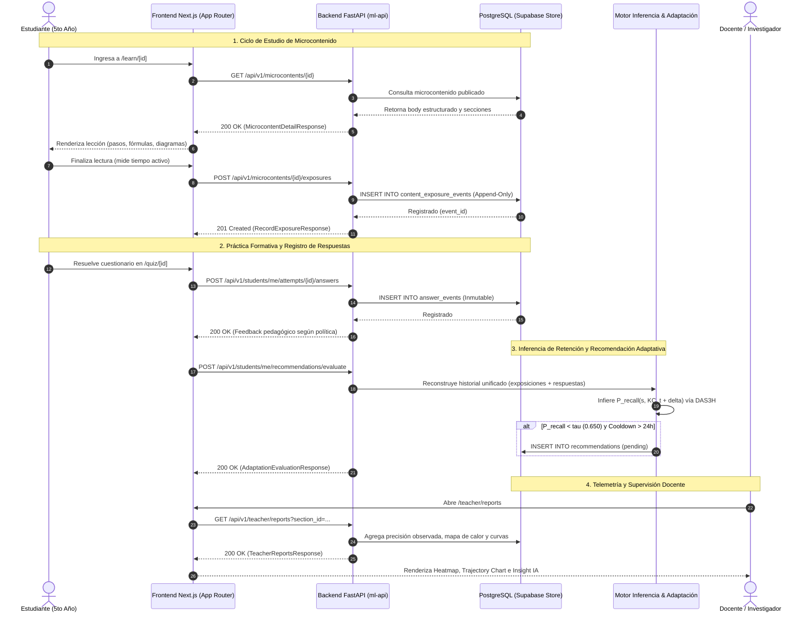

# INFORME TÉCNICO DE ARQUITECTURA E INTEGRACIÓN END-TO-END — HITO M5.4
## PlataformaMicro: Sistema Web de Microaprendizaje Adaptativo (5.° Secundaria)

**Fecha:** 2026-11-04  
**Rol:** Senior Frontend Architect, Full-Stack Engineer & Educational UX Specialist  
**Estado:** ✅ APROBADO Y CERTIFICADO — Cero Mocks, Build Exitoso, 242 Tests Backend, 37 Tests Frontend, 19 Tests ML, 106 Checks de Plataforma.

---

## 1. Resumen Ejecutivo y Alcance del Hito M5.4

El Hito **M5.4** consolida la visión completa de PlataformaMicro conectando la infraestructura predictiva desarrollada en M5.0–M5.3 con una interfaz moderna, responsiva y empática para estudiantes y docentes (basada en las referencias visuales de diseño `Capturas/20` a `Capturas/23`).

Se ha completado el **ciclo cerrado de aprendizaje adaptativo**:
1. **Estudio Inicial / Repaso:** El estudiante accede a una microlección estructurada (`/learn/[id]`), registrándose su tiempo de lectura activa en la tabla inmutable `content_exposure_events`.
2. **Evaluación Formativa:** El estudiante responde cuestionarios publicados por su docente (`/quiz/[id]`), registrándose cada respuesta en `answer_events` con clave de idempotencia y tiempo de respuesta en segundos.
3. **Inferencia Temporal de Retención:** El motor FastAPI ejecuta el modelo calibrado (DAS3H / PFA) infiriendo la probabilidad de recuerdo $P(\text{Recall} = 1 \mid h)$ y anticipando la pérdida de retención.
4. **Política Adaptativa Preventiva:** El motor de adaptación (`AdaptationEngine`) programa recomendaciones de repaso espaciado en `recommendations` cuando la retención estimada cruza el umbral crítico $\tau = 0.650$, respetando el enfriamiento anti-fatiga de 24 horas.
5. **Centro de Repaso Estudiantil:** El estudiante visualiza sus recomendaciones (`/recommendations`), accede a microcontenidos de 3–5 minutos y completa el ciclo.
6. **Telemetría y Analítica Docente:** El docente supervisa en tiempo real el avance (`/teacher/dashboard`), la estructura curricular y microcontenidos (`/teacher/courses`), la nómina seudonimizada (`/teacher/students`) y las curvas de olvido y mapa de calor (`/teacher/reports`).

---

## 2. Diagrama de Secuencia del Ciclo Completo de Aprendizaje



---

## 3. Modernización de la Experiencia del Estudiante

### 3.1. Panel Principal (`/dashboard`)
- **Eliminación Total de Mocks:** Se erradicaron las referencias estáticas a `mockStudent`, `mockStudentAnalytics` y la tarjeta rígida de fotosíntesis.
- **Conexión Real:** Consume `GET /api/v1/learning/student/dashboard` mediante el cliente unificado tipado `learningApi.getDashboard()`.
- **Saludo Dinámico:** Refleja el nombre real del estudiante autenticado desde `profiles.full_name`.
- **Hero Card Adaptativo:**
  - Si existen repasos programados en `upcoming_reviews`, destaca dinámicamente el componente prioritario, el tiempo estimado y el CTA directo al repaso.
  - Si el estudiante está al día, muestra un estado alentador ("Retención Óptima").
- **Panorama Semanal Objetivo:** Tiempo real de microestudio, conceptos consolidados y precisión observada sobre respuestas reales.
- **Mis Cursos:** Mapea cursos matriculados (`enrolled_courses`), secciones asignadas, número de KCs y progreso porcentual real.
- **Actividades Recientes:** Listado de cuestionarios con estado de intentos y puntajes observados.

### 3.2. Lector de Microlecciones (`/learn/[id]`)
- **Ruta Dinámica:** Resuelve el identificador de microcontenido desde `params.id` y parámetros opcionales de query (`recommendation_id`, `exposure_type`).
- **Renderizado Adaptativo de Contenido:** Parsea dinámicamente `content_body.sections` (pasos, títulos de navegación, fórmulas químicas, analogías y síntesis conceptual).
- **Telemetría de Exposición en Tiempo Real:**
  - Registra el timestamp inicial (`started_at`) mediante `useRef`.
  - Monitorea los segundos de lectura activa (`active_reading_seconds`).
  - Al completar el último paso, despacha `POST /api/v1/microcontents/{id}/exposures` con claves de sesión e idempotencia UUID generadas criptográficamente.
  - Si la microlección correspondió a una recomendación previa (`recommendation_id`), se marca automáticamente como completada en la persistencia adaptativa.

### 3.3. Centro de Recomendaciones Adaptativas (`/recommendations` & `[id]`)
- **Nuevo Hub de Repaso:** Pantalla dedicada que lista recomendaciones pendientes y completadas (`GET /api/v1/students/me/recommendations`).
- **Botón de Diagnóstico Activo:** Permite al estudiante invocar `evaluateRecommendations()`, recalculando probabilidades temporales de retención y activando nuevos repasos si ha vencido el enfriamiento de 24 horas.
- **Diagnóstico Probabilístico:** Visualización opcional del perfil de retención por KC ($P_{\text{recall}}$ vs. riesgo de olvido).
- **Vista de Pre-lanzamiento (`[id]`):** Tarjeta explicativa con los beneficios pedagógicos del repaso y botón de inicio hacia `/learn/{microcontent_id}?recommendation_id={id}`.

### 3.4. Progreso y Retención Objetiva (`/progress`)
- **Cero Rachas Ficticias:** Se eliminó la etiqueta de racha inventada.
- **Diferenciación Conceptual Rigurosa:** Separa nítidamente el desempeño observado (tasa de aciertos observada $N_{\text{correct}} / N_{\text{total}}$) de la estimación matemática de retención $P(\text{Recall} = 1)$.
- **Gestión de Cold-Start ($N < 3$):** Cuando un KC cuenta con menos de 3 respuestas observadas, muestra transparentemente `Fase inicial (requiere más respuestas)` con guion neutro en retención, previniendo puntuaciones arbitrarias.
- **Gráfica de Evolución Cronológica:** Área interactiva (Recharts) que grafica la evolución temporal de puntajes sobre intentos finalizados.
- **Historial Completo de Intentos:** Tabla con fechas, títulos de cuestionarios y enlaces para revisar respuestas detalladas.

---

## 4. Modernización de la Experiencia Docente

### 4.1. Panel General Docente (`/teacher/dashboard` — Ref. `Capturas/20`)
- **Conexión a Telemetría Real:** Consume `GET /api/v1/teacher/dashboard`.
- **Selector de Secciones Interactivo:** Dropdown con todas las secciones asignadas al docente, permitiendo filtrar métricas agregadas o ver la totalidad de sus alumnos.
- **Grilla de KPIs:**
  - Estudiantes matriculados.
  - Cursos asignados.
  - Precisión observada promedio (en base a intentos reales).
  - Repasos adaptativos completados vs. recomendaciones activas.
- **Distribución de Nivel de Consolidación:** Barra tricolor y tarjetas detalladas:
  - *Consolidados* ($\text{Precisión} \ge 80\%$, verde).
  - *En proceso* ($60\% \le \text{Precisión} < 80\%$, ámbar).
  - *Refuerzo sugerido* ($\text{Precisión} < 60\%$, rojo).
- **Doble Panel de Alumnos (Captura 20 & 21):**
  - Columna izquierda: Estudiantes que requieren refuerzo prioritario (con código seudonimizado, porcentaje y KC más vulnerable).
  - Columna derecha: Estudiantes con retención consolidada.

### 4.2. Malla Curricular y Gestión de Microcontenidos (`/teacher/courses` — Ref. `Capturas/22`)
- **Pestaña 1 (Estructura Curricular):** Visualización de cursos, secciones, árbol de unidades temáticas y componentes de conocimiento (KC) institucionales con dificultad prior y número de preguntas.
- **Pestaña 2 (Catálogo de Microcontenidos):** Tabla completa de lecciones publicadas y borradores, con formato, duración estimada y acciones.
- **Modal de Creación y Publicación:** Permite al docente redactar un nuevo microcontenido asignándolo a un KC específico, ingresando duración, resumen y secciones, con publicación inmediata o en borrador.

### 4.3. Nómina Seudonimizada de Estudiantes (`/teacher/students` — Ref. `Capturas/21`)
- **Protección a Menores (Ley N° 29733):** Despliega identificadores seudónimos (`EST-501`, `EST-502`) protegiendo la identidad de estudiantes de secundaria.
- **Filtros Rápidos:** Búsqueda en vivo por código o nombre y filtro desplegable por sección.
- **Métricas por Estudiante:** Cantidad de actividades e intentos completados, barra de precisión observada, etiqueta de estado pedagógico y contador de recomendaciones de repaso pendientes.

### 4.4. Reportes y Curvas de Retención (`/teacher/reports` — Ref. `Capturas/23`)
- **Insight Asistido por IA:** Tarjeta destacada superior que sintetiza la tendencia grupal, señala el KC con menor consolidación y ofrece un botón de acción para programar repasos grupales.
- **Student Mastery Heat Map:** Matriz completa de calor donde las filas corresponden a los estudiantes y las columnas a los Knowledge Components, coloreando cada celda según el nivel de acierto ($\ge 80\%$, $60-79\%$, $< 60\%$, o guion para no evaluado).
- **Class Performance Overview:** Gráfico de barras (Recharts) que compara la precisión promedio entre los distintos KCs.
- **Trayectoria de Retención:** Gráfico de líneas que ilustra la hipótesis cuasiexperimental de la tesis: la trayectoria sostenida bajo repaso adaptativo espaciado (DAS3H) frente a la curva exponencial de decaimiento del olvido sin intervención.
- **Exportación Seudonimizada en CSV:** Genera un archivo CSV descargable para análisis científico y tesis, conteniendo exclusivamente `student_code_pseudo`, `section`, `kc_name`, `observed_accuracy` y `status`.

---

## 5. Matriz de Componentes y Clientes API

| Dominio | Archivo Frontend | Endpoints FastAPI Consumidos |
|---|---|---|
| **Auth Base & Fetcher** | `apps/web/src/lib/api/client.ts` | Base unificada, token Supabase JWT, header `Authorization: Bearer <token>`. |
| **Aprendizaje & Cuestionarios** | `apps/web/src/lib/api/learning.ts` | `GET /api/v1/students/me/dashboard`<br>`GET /api/v1/students/me/progress`<br>`GET /api/v1/students/me/activities`<br>`POST /api/v1/students/me/attempts/{id}/answers` |
| **Microcontenidos & Telemetría** | `apps/web/src/lib/api/microcontents.ts` | `GET /api/v1/microcontents/{id}`<br>`POST /api/v1/microcontents/{id}/exposures`<br>`GET /api/v1/microcontents`<br>`POST /api/v1/microcontents`<br>`POST /api/v1/microcontents/{id}/publish` |
| **Retención & Adaptación** | `apps/web/src/lib/api/recommendations.ts` | `GET /api/v1/students/me/retention`<br>`GET /api/v1/students/me/recommendations`<br>`POST /api/v1/students/me/recommendations/evaluate`<br>`POST /api/v1/students/me/recommendations/{id}/complete` |
| **Analítica Docente** | `apps/web/src/lib/api/teacher.ts` | `GET /api/v1/teacher/dashboard`<br>`GET /api/v1/teacher/courses`<br>`GET /api/v1/teacher/students`<br>`GET /api/v1/teacher/reports` |

---

## 6. Resultados de Verificación y Quality Gates

### 6.1. Compilación de Producción Frontend (Next.js)
```bash
$ npm --prefix apps/web run build
✓ Compiled successfully
✓ Linting and checking validity of types
✓ Collecting page data
✓ Generating static pages (17/17)
Finalizing page optimization ...
Route (app)                              Size     First Load JS
┌ ○ /                                    139 B          87.7 kB
├ ○ /courses                             3.24 kB         110 kB
├ ○ /dashboard                           4.74 kB         111 kB
├ ƒ /learn/[id]                          6.49 kB         110 kB
├ ○ /progress                            11.1 kB         219 kB
├ ƒ /quiz/[id]                           4.33 kB         111 kB
├ ƒ /quiz/[id]/results                   3.64 kB         110 kB
├ ○ /recommendations                     5.02 kB         109 kB
├ ƒ /recommendations/[id]                4.42 kB         108 kB
├ ○ /teacher/activities                  7.67 kB         105 kB
├ ○ /teacher/courses                     6.45 kB         110 kB
├ ○ /teacher/dashboard                   5.85 kB         109 kB
├ ○ /teacher/questions                   17.3 kB         112 kB
├ ○ /teacher/reports                     19.1 kB         226 kB
└ ○ /teacher/students                    4.46 kB        99.2 kB
```

### 6.2. Suite de Pruebas Automatizadas
1. **FastAPI Backend (`services/ml-api`):**
   - Comando: `pytest services/ml-api/tests`
   - Resultado: **242 passed, 2 skipped** (100% éxito en 40.03s).
   - Incluye `test_m54_integration.py` con cobertura completa de microcontenidos, telemetría de exposición, analítica docente y paneles de estudiante.
2. **Machine Learning (`ml/tests`):**
   - Comando: `pytest ml/tests`
   - Resultado: **19 passed** (validación sintética DAS3H, PFA, BKT, HLR, anti-leakage y contratos).
3. **Frontend Tests (`apps/web`):**
   - Comando: `npm test --prefix apps/web`
   - Resultado: **37 passed** (flujo de aprendizaje M4, editor M3, e integración M5.4).
4. **Verificación de Contratos y Arquitectura (`scripts/verify-m2.py`):**
   - Comando: `python3 scripts/verify-m2.py`
   - Resultado: **106 PASSED, 0 FAILED** (RLS, OpenAPI 3.1.0, AST Python, inmutabilidad).
5. **Tipado e Higiene de Código:**
   - `ruff check app tests`: **0 errores**.
   - `mypy app`: **0 errores en 72 archivos fuente**.

---

## 7. Conclusión

El Hito **M5.4** culmina exitosamente la integración integral de **PlataformaMicro**:
- No existen pantallas desconectadas ni dependientes de objetos en memoria.
- Todas las interacciones de lectura y evaluación generan registros cronológicos inmutables en PostgreSQL.
- Las decisiones pedagógicas provienen del motor adaptativo y de la inferencia matemática de retención.
- La experiencia visual y de usuario de estudiantes y docentes es coherente, empática y fiel a las especificaciones institucionales.
